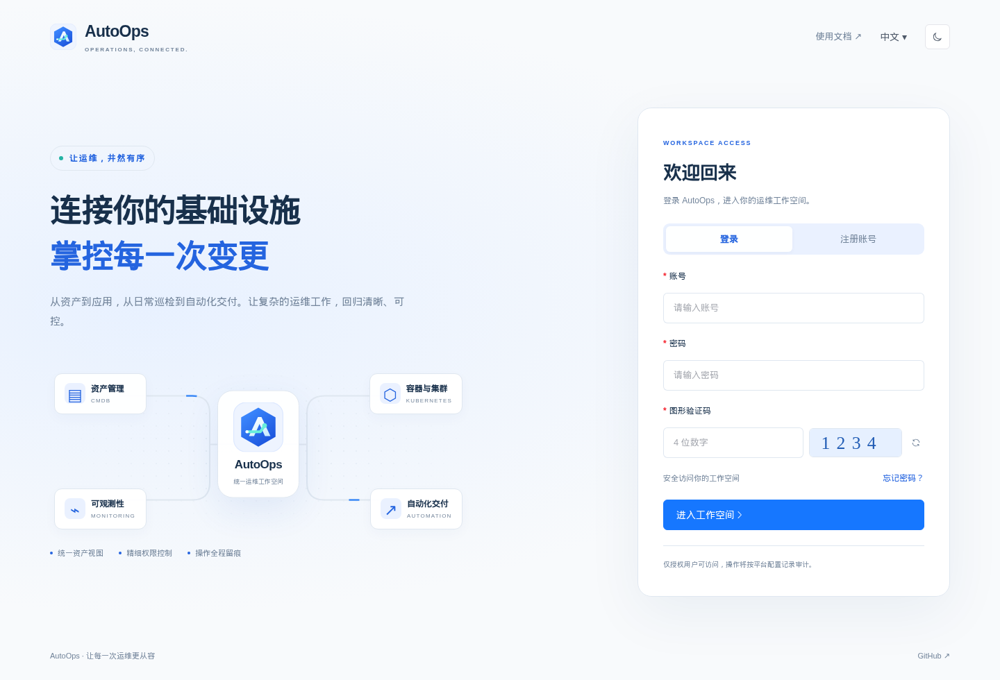
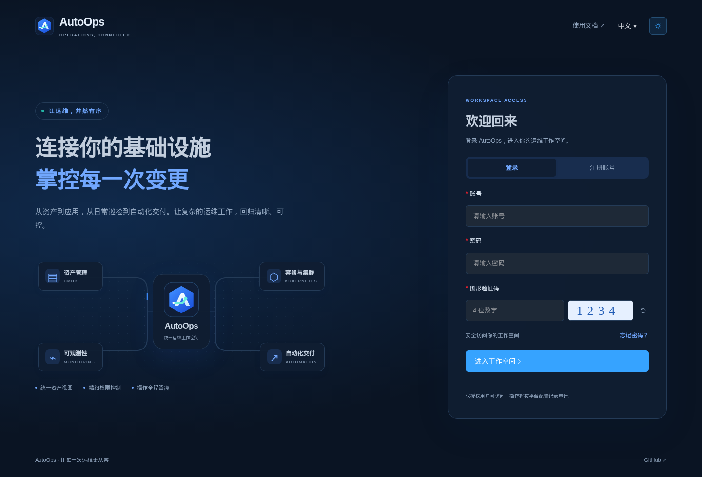
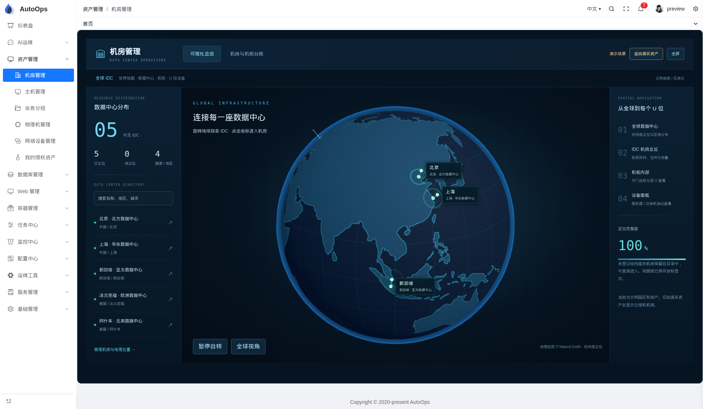
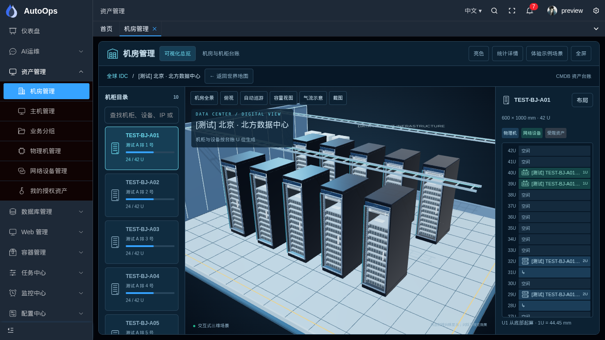
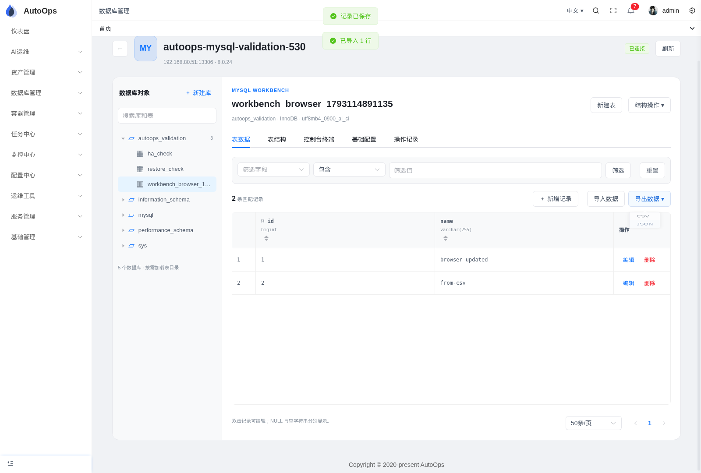
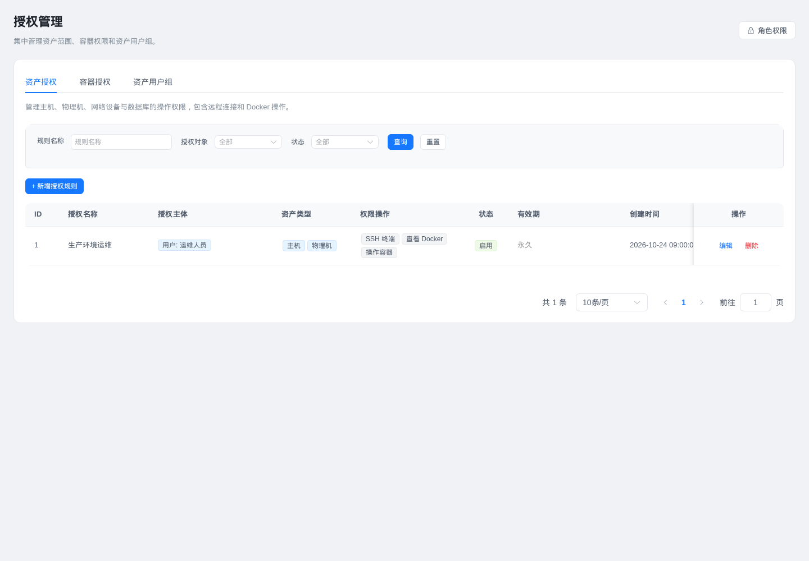

<div align="center">
  <picture>
    <source media="(prefers-color-scheme: dark)" srcset="web/public/assets/brand/mark-dark.svg">
    
  </picture>
  <h1>AutoOps · 天枢</h1>
  <p><strong>连接你的基础设施，掌控每一次变更。</strong></p>
  <p>资产 · Kubernetes · 数据库 · Web 服务 · 自动化 · 可观测性</p>
  <p>
    <a href="https://github.com/zhou2004/AutoOps/releases"></a>
    <a href="https://github.com/zhou2004/AutoOps/actions/workflows/docker-publish.yml"></a>
    
    
  </p>
  <p><a href="#快速开始">快速开始</a> · <a href="#效果展示">效果展示</a> · <a href="docs/README.md">文档中心</a> · <a href="https://github.com/zhou2004/AutoOps/releases">版本下载</a></p>
</div>

---

AutoOps 是基于 **Go + Vue 3** 的运维管理平台。把资产台账、主机连接、容器与集群、数据库、Web 服务、任务执行和操作审计放进同一个工作空间，支持中文 / English 与完整亮暗主题。

## 效果展示

<table>
<tr><td width="50%"><strong>清晰的工作空间入口 · 亮色</strong><br></td><td width="50%"><strong>适合长时间工作的暗色主题</strong><br></td></tr>
<tr><td><strong>从全球 IDC 到每一个 U 位</strong><br></td><td><strong>机柜下钻与设备巡检</strong><br></td></tr>
<tr><td><strong>数据库查询与管理工作台</strong><br></td><td><strong>明确的资产范围与操作权限</strong><br></td></tr>
</table>

截图为实际界面，部分资产展示使用标记的示例数据。更多效果图见 [assets/screenshots](assets/screenshots)。

## 快速开始

| 安装方式 | 适合场景 | 教程 |
|---|---|---|
| **Docker Compose** | 快速体验、单机部署；依赖一并启动 | [Docker 安装 →](docs/installation/docker.md) |
| **源码** | 本地开发、调试、二次开发 | [源码安装 →](docs/installation/source.md) |
| **Kubernetes** | 已有集群，使用 Secret / PVC 管理配置与数据 | [K8s 安装 →](docs/installation/kubernetes.md) |

首次体验建议使用 Docker：

```bash
git clone --branch v1.1.0 https://github.com/zhou2004/AutoOps.git
cd AutoOps
bash docker/setup.sh
cd docker
docker compose up -d
```

等待 MySQL 和 API 初始化，打开 **http://localhost:8080**。用户名为 `admin`，初始密码查看生成的 `docker/.env` 中 `AUTOOPS_INITIAL_ADMIN_PASSWORD`。每次全新安装生成独立凭据，本地配置不会提交 Git。

已有部署升级请先阅读 [升级与数据保留](docs/installation/docker.md#数据备份与升级)，沿用原数据目录、连接配置与加密密钥。

## 能力一览

| 领域 | 已提供能力 |
|---|---|
| **资产与机房** | 主机、物理机、网络设备；机房 → 机柜 → U 位台账与 Three.js 可视化；多协议连接配置 |
| **容器与集群** | Docker 容器、镜像和网络管理；Kubernetes 多集群、节点、工作负载、配置与资源权限 |
| **数据库** | MySQL、PostgreSQL、Redis 数据源与工作台；集群、高可用、备份恢复、日志与审计 |
| **Web 服务** | Nginx 主机 / Docker、站点与配置发布、证书、日志、流量、防护、上游与 VIP |
| **任务与自动化** | Shell / Python / Ansible 任务、分组、参数、定时执行、实时日志与历史记录 |
| **监控中心** | 主机监控、域名证书自动巡检、API 端点、告警规则与故障管理 |
| **权限与账号** | 用户、角色、细粒度资源授权、API Token；邮箱验证注册、管理员审批、密码找回 |
| **AI 运维** | 模型接入、持续对话、诊断、Skills、工作流及限定范围的操作授权 |

远程连接和自动化执行需要目标协议、网络和凭据就绪；3D 气流与灯光为展示示意，不能替代真实传感器监控。

## 文档导航

- **安装**：[源码](docs/installation/source.md) · [Docker](docs/installation/docker.md) · [Kubernetes](docs/installation/kubernetes.md)
- **账号与权限**：[邮箱验证与密码找回](docs/account-access.md) · [角色与 API Token](docs/2026-10-21-platform-permissions-tokens.md)
- **资产**：[机房可视化](docs/2026-11-14-datacenter-3d.md) · [Docker 管理](docs/2026-10-16-docker-management.md)
- **运维工作台**：[数据库](docs/database-management-plan.md) · [Web 管理](docs/2026-11-09-web-management.md) · [AI 运维](docs/2026-10-20-aiops-i18n.md)
- **版本**：[v1.1.0 更新内容](docs/releases-v1.1.0.md) · [全部文档](docs/README.md)

## 项目结构

```text
api/                   Go API、后台采集与任务执行器
web/                   Vue 3、Element Plus、Three.js 前端
assets/screenshots/    README 与文档效果图
web/public/assets/     明暗品牌图标等公开资源
docker/                镜像构建、Compose、安装初始化
k8s/quickstart/         Kustomize 入门部署
docs/installation/     三种安装教程
.agents/skills/        模块维护与界面规范
```

## 版本与镜像

版本标签触发测试、双端镜像构建、GitHub Packages 和 Docker Hub 发布。镜像带有源码仓库及 commit 标签，Release 附更新说明、部署文件包和 SHA-256 校验值。

| 组件 | Docker Hub | GitHub Packages |
|---|---|---|
| API / Worker | `feelzhou/autoops-api:v1.1.0` | `ghcr.io/zhou2004/autoops-api:v1.1.0` |
| Web | `feelzhou/autoops-web:v1.1.0` | `ghcr.io/zhou2004/autoops-web:v1.1.0` |

[查看 Releases](https://github.com/zhou2004/AutoOps/releases) · [查看 Packages](https://github.com/zhou2004?tab=packages&repo_name=AutoOps) · [查看构建记录](https://github.com/zhou2004/AutoOps/actions)

## 开发与贡献

```bash
# 后端测试
(cd api && go test ./...)
# 前端校验与构建
(cd web && pnpm install --frozen-lockfile && pnpm i18n:test && pnpm build)
```

问题反馈请附版本、复现步骤和脱敏日志。功能修改请同步 API、界面、权限和文档；不要提交本地配置、授权码、私钥、运行日志或真实业务数据。

本项目在 [opsre/AutoOps](https://github.com/opsre/AutoOps) 基础上持续完善，感谢上游及社区贡献。前端基础框架与第三方组件的许可保留在各自目录，例如 [web/LICENSE](web/LICENSE)。
