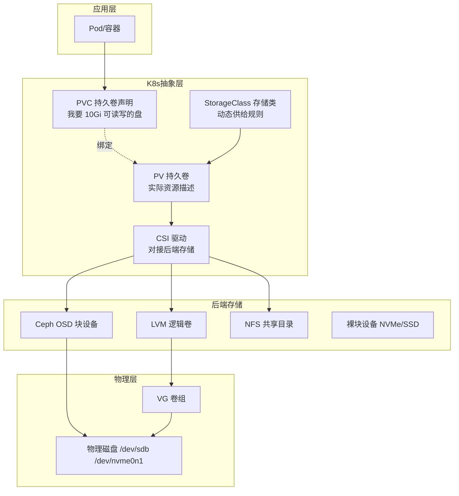
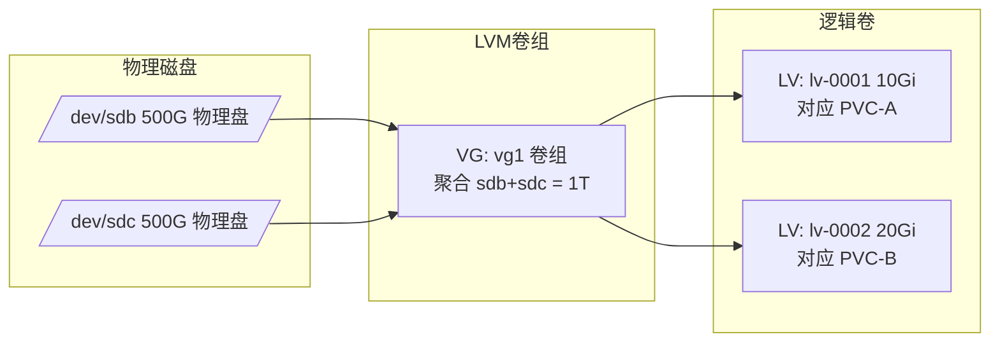
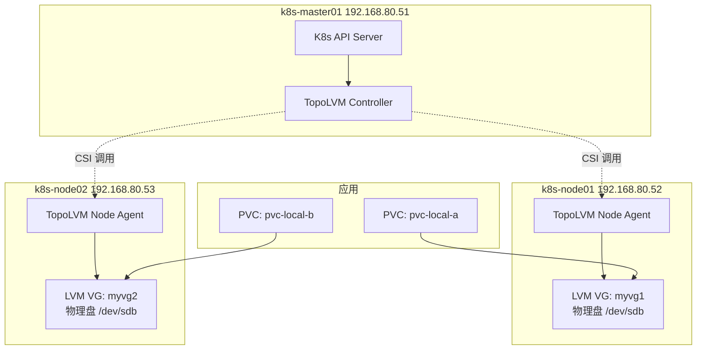
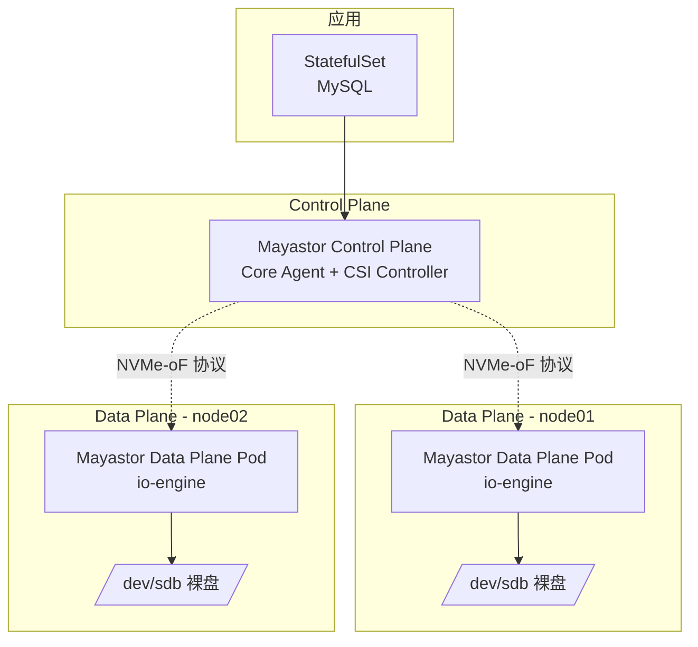
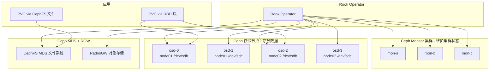
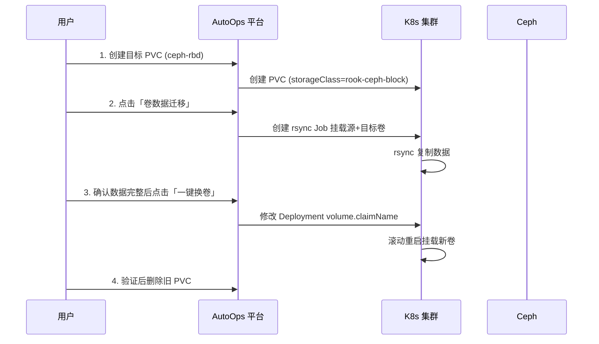

# K8s 持久化存储方案实战指南

> 本文档面向 AutoOps 平台，讲解 K8s 持久化存储的底层原理、主流方案对比，以及针对
> `192.168.80.51/52/53` 三节点环境的实战搭建（Ceph + Rook、OpenEBS Mayastor、TopoLVM）。

---

## 一、底层原理：PV/PVC 如何映射到硬盘逻辑卷

### 1.1 抽象层次总览

K8s 存储的核心是把「用户想要一块盘」和「系统实际在哪块盘上」解耦。完整链路如下：



### 1.2 PV/PVC/StorageClass 三者的关系

| 概念 | 作用 | 类比 |
|------|------|------|
| **PV** | 集群管理员提供的「实际存储资源」，描述容量、访问模式、后端位置 | 一块已经格式化好的盘 |
| **PVC** | 用户对存储的「申请单」，声明容量和访问模式 | 「我要 10Gi 的盘」 |
| **StorageClass** | 动态供给的「工厂」，PVC 来了自动创建 PV | 自动开卡发卡机 |

**绑定过程**：
1. 用户创建 PVC（声明 10Gi）
2. 若有 StorageClass，CSI provisioner 自动创建 PV 并绑定
3. 若无 SC，则匹配已有 PV（静态供给）

### 1.3 LVM（逻辑卷管理）映射原理 —— 以 TopoLVM 为例

这是最贴近「硬盘 → 逻辑卷」的方案，能直观理解底层映射：



**映射链路（TopoLVM）**：

```
物理磁盘 /dev/sdb
  └─ pvcreate  →  LVM PV（物理卷）
      └─ vgcreate →  LVM VG（卷组 vg1）
          └─ lvcreate →  LVM LV（逻辑卷，如 /dev/vg1/lv-0001）
              └─ mkfs.ext4 →  文件系统
                  └─ TopoLVM CSI →  挂载到 Pod 容器
                      └─ 对应到 K8s PVC/PV
```

**关键结论**：
- 一块物理盘可以切成多个 LV，每个 LV 对应一个 K8s PV
- LVM 支持**在线扩容**（lvextend），这也是 PVC 扩容的底层能力
- TopoLVM 用 LVM 的 **thin provisioning（精简供给）**，实现按需分配

### 1.4 主流方案对比

| 方案 | 类型 | 可靠性 | 性能 | 运维复杂度 | 最佳场景 |
|------|------|--------|------|-----------|---------|
| **Ceph + Rook** | 分布式块/文件/对象 | ⭐⭐⭐⭐⭐ | ⭐⭐⭐⭐ | ⭐⭐⭐ | 大规模生产、多租户、统一存储 |
| **Longhorn** | 云原生分布式块 | ⭐⭐⭐⭐ | ⭐⭐⭐ | ⭐⭐ | 中小集群、快速上手、备份恢复 |
| **OpenEBS Mayastor** | 云原生高性能块 | ⭐⭐⭐⭐ | ⭐⭐⭐⭐⭐ | ⭐⭐⭐ | 数据库、NVMe、低延迟 |
| **TopoLVM** | 本地盘虚拟化 | ⭐⭐⭐⭐ | ⭐⭐⭐⭐⭐ | ⭐⭐ | 单节点高性能、有状态应用 |
| **NFS + CSI** | 共享文件 | ⭐⭐⭐ | ⭐⭐ | ⭐ | 共享配置、多读多写 |

---

## 二、三方案架构图

### 2.1 方案一：TopoLVM（最简单，本地盘虚拟化）



**特点**：数据在本地节点，性能最好；但 Pod 不能跨节点漂移（本地卷限制）。

### 2.2 方案二：OpenEBS Mayastor（高性能云原生块）



**特点**：基于 NVMe-oF 协议，跨节点网络块存储，支持副本（数据复制到多节点），性能接近本地盘。

### 2.3 方案三：Ceph + Rook（最复杂，分布式统一存储）



**特点**：三副本高可用，块/文件/对象三合一，支持跨节点和集群扩展，适合大规模生产。

---

## 三、实战搭建步骤

### 3.0 前置准备（三台主机）

```bash
# 每台主机都执行
# 1. 确认内核模块
modprobe rbd
modprobe nvme-tcp
modprobe nvme-fabrics

# 2. 关闭 swap（K8s 要求）
swapoff -a
sed -i '/swap/d' /etc/fstab
```

### 3.1 方案一：TopoLVM（推荐先做，最简单）

**步骤 1：安装 TopoLVM**

```bash
# 使用 Helm 安装
helm repo add topolvm https://topolvm.github.io/topolvm
helm repo update
helm install topolvm topolvm/topolvm \
  --namespace topolvm-system \
  --create-namespace
```

**步骤 2：为节点创建 LVM 卷组**

```bash
# 在 node01 (192.168.80.52) 上执行
ssh root@192.168.80.52
# 假设有一块空盘 /dev/sdb
pvcreate /dev/sdb
vgcreate myvg1 /dev/sdb

# 在 node02 (192.168.80.53) 上执行
ssh root@192.168.80.53
pvcreate /dev/sdb
vgcreate myvg2 /dev/sdb
```

**步骤 3：创建 StorageClass 并测试**

```bash
cat <<EOF | kubectl apply -f -
apiVersion: storage.k8s.io/v1
kind: StorageClass
metadata:
  name: topolvm-provisioner
provisioner: topolvm.io
parameters:
  "csi.storage.k8s.io/fstype": "xfs"
volumeBindingMode: WaitForFirstConsumer
allowVolumeExpansion: true
EOF

# 创建测试 PVC
cat <<EOF | kubectl apply -f -
apiVersion: v1
kind: PersistentVolumeClaim
metadata:
  name: test-pvc-topolvm
  namespace: test_pv
spec:
  storageClassName: topolvm-provisioner
  accessModes: [ReadWriteOnce]
  resources:
    requests:
      storage: 5Gi
EOF
```

### 3.2 方案二：OpenEBS Mayastor（中等复杂度）

**步骤 1：安装 OpenEBS Mayastor**

```bash
helm repo add openebs https://openebs.github.io/openebs
helm repo update
helm install mayastor openebs/mayastor \
  --namespace mayastor \
  --create-namespace
```

**步骤 2：配置磁盘池（每节点）**

```bash
# 在每个节点创建磁盘池，添加裸盘
cat <<EOF | kubectl apply -f -
apiVersion: "openebs.io/v1"
kind: DiskPool
metadata:
  name: pool-node01
  namespace: mayastor
spec:
  node: k8s-node01
  disks: ["/dev/sdb"]
EOF
```

**步骤 3：创建 StorageClass 并测试**

```bash
cat <<EOF | kubectl apply -f -
apiVersion: storage.k8s.io/v1
kind: StorageClass
metadata:
  name: mayastor-2
provisioner: io.openebs.csi-mayastor
parameters:
  repl: "2"          # 双副本
  protocol: "nvmf"
  thin: "true"
EOF
```

### 3.3 方案三：Ceph + Rook（最复杂，完整生产方案）

**步骤 1：安装 Rook Operator**

```bash
git clone --single-branch --branch v1.14.0 https://github.com/rook/rook.git
cd rook/deploy/examples
kubectl create -f crds.yaml -f common.yaml -f operator.yaml
```

**步骤 2：部署 Ceph 集群**

```bash
# 修改 cluster.yaml 指定节点和磁盘
cat <<EOF | kubectl apply -f -
apiVersion: ceph.rook.io/v1
kind: CephCluster
metadata:
  name: rook-ceph
  namespace: rook-ceph
spec:
  cephVersion:
    image: quay.io/ceph/ceph:v18.2.0
  dataDirHostPath: /var/lib/rook
  mon:
    count: 3
    allowMultiplePerNode: false
  storage:
    useAllNodes: true
    useAllDevices: false
    nodes:
      - name: "k8s-node01"
        devices:
          - name: "sdb"
          - name: "sdc"
      - name: "k8s-node02"
        devices:
          - name: "sdb"
          - name: "sdc"
EOF
```

**步骤 3：创建 RBD StorageClass 并测试**

```bash
# 创建池
cat <<EOF | kubectl apply -f -
apiVersion: ceph.rook.io/v1
kind: CephBlockPool
metadata:
  name: replicapool
  namespace: rook-ceph
spec:
  failureDomain: host
  replicated:
    size: 3
EOF

# 创建 StorageClass
cat <<EOF | kubectl apply -f -
apiVersion: storage.k8s.io/v1
kind: StorageClass
metadata:
  name: rook-ceph-block
provisioner: rook-ceph.rbd.csi.ceph.com
parameters:
  clusterID: rook-ceph
  pool: replicapool
  imageFormat: "2"
  csi.storage.k8s.io/provisioner-secret-name: rook-csi-rbd-provisioner
  csi.storage.k8s.io/provisioner-secret-namespace: rook-ceph
EOF
```

---

## 四、接入 AutoOps 平台管理

### 4.1 在平台添加 K8s 集群

1. 进入「K8s 管理」→「集群管理」
2. 点击「添加集群」，选择「导入集群」
3. 上传 master01 的 kubeconfig（`/root/.kube/config`）
4. 保存后平台自动同步集群状态

### 4.2 在存储管理界面操作

部署完上述任一方案后，进入「K8s 存储管理」：

| 操作 | 路径 | 说明 |
|------|------|------|
| 界面创建 StorageClass | StorageClass 标签 → 创建 | 下拉选择 provisioner（rook-ceph/mayastor/topolvm） |
| 界面创建 PVC | PVC 标签 → 创建 | 选择存储类、容量、访问模式 |
| 界面创建 PV | PV 标签 → 创建 | 选择卷类型（hostPath/NFS/Local/CSI） |
| PVC 扩容 | PVC 操作列 → 扩容按钮 | 在线扩容（需 SC 开启 allowVolumeExpansion） |
| 卷数据迁移 | PVC 操作列 → 迁移按钮 | rsync 将源卷复制到目标卷 |
| 一键换卷 | PVC 操作列 → 换卷按钮 | 将工作负载的 PVC 替换为新卷 |
| 设置默认 SC | SC 操作列 → 默认按钮 | 一键设置/取消默认存储类 |

---

## 五、存储迁移完整流程示例

以「将本地卷迁移到 Ceph RBD」为例：



---

## 六、选型建议

| 场景规模 | 推荐方案 | 理由 |
|----------|---------|------|
| **3 节点测试/学习** | TopoLVM | 最简单，一条命令部署，本地盘性能 |
| **中小集群（10 节点内）** | OpenEBS Mayastor | 高性能、副本、快速上手 |
| **大规模生产（10+ 节点）** | Ceph + Rook | 统一存储、三副本高可用、块/文件/对象 |

> 针对本环境（3 节点 192.168.80.51/52/53），建议**优先搭建 TopoLVM** 验证存储管理功能，
> 然后逐步升级到 OpenEBS Mayastor 和 Ceph + Rook。
