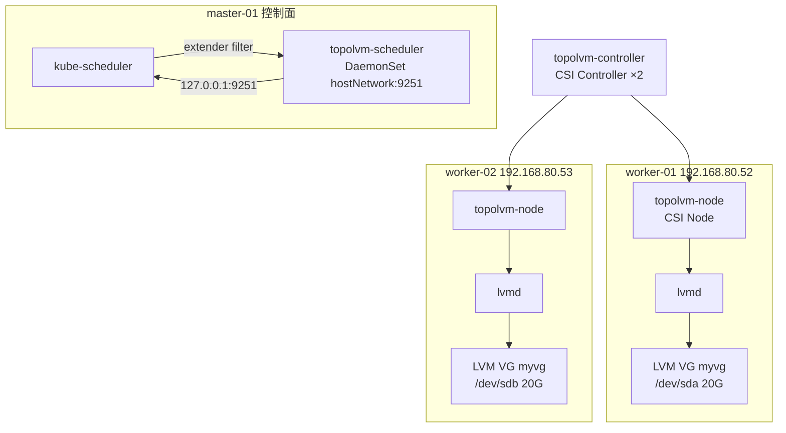

# TopoLVM 本地盘存储方案 — 使用教程与维护文档

> 日期：2026-08-15　|　集群：K8s v1.34.3 三节点　|　TopoLVM：v0.41.0（Helm chart 17.1.0）

## 1. 概述

**TopoLVM** 是一个基于 **LVM（Logical Volume Manager）** 的 Kubernetes CSI 插件，属于
**本地盘虚拟化（Local PV）** 方案。它将节点的物理磁盘划分为 LVM 卷组（VG），通过 CSI
动态供给为 PV，实现"本地盘 + 动态供给 + 容量隔离"。

**为什么选 TopoLVM：**
- 本地盘，性能接近裸盘（无网络存储开销），延迟低、吞吐高
- 基于成熟 LVM 技术，支持在线扩容、快照、精简配置（thin provisioning）
- 无需额外存储硬件（如 Ceph OSD），单机独立盘即可
- 相比 OpenEBS/Ceph 更轻量，运维简单

**局限：** 数据绑定到单节点（本地盘），节点故障数据需靠备份/快照恢复，不具备跨节点副本。

## 2. 集群环境与本方案部署结果

| 节点 | IP | 角色 | 数据盘 | LVM 卷组 |
|------|-----|------|--------|----------|
| master-01 | 192.168.80.51 | 控制面（仅 scheduler 扩展） | - | - |
| worker-01 | 192.168.80.52 | worker | /dev/sda 20G | `myvg` |
| worker-02 | 192.168.80.53 | worker | /dev/sdb 20G | `myvg` |

**部署结果（已验证）：**
- TopoLVM 组件全部 Running：`topolvm-controller`×2、`topolvm-lvmd`×2、`topolvm-node`×2、`topolvm-scheduler`×1
- StorageClass：`topolvm-provisioner`（默认，WaitForFirstConsumer，允许扩容）
- 测试 MySQL StatefulSet 双副本：`test-mysql-0`→worker-01，`test-mysql-1`→worker-02
- 数据持久化、在线扩容、调度按容量均验证通过

## 3. 架构与数据流



**调度/供给流程：**
1. 用户创建 PVC（StorageClass=`topolvm-provisioner`，`WaitForFirstConsumer`）
2. 创建 Pod 消费 PVC，kube-scheduler 通过 TopoLVM extender 按**节点可用容量**选择目标节点
3. 选定节点后，topolvm-controller 调用该节点 lvmd 在 `myvg` 上创建 LV 逻辑卷
4. topolvm-node 格式化（ext4）并挂载到 Pod

## 4. 部署步骤（已执行，可复用脚本）

### 4.1 前置条件

1. **节点安装 LVM 工具**：`apt-get install -y lvm2 thin-provisioning-tools`
   （worker 还需 `mkfs.ext4`，属于 e2fsprogs，默认已装）
2. **master 安装 helm3**
3. **containerd 配置国内镜像源**（详见 `k8s/storage/topolvm/containerd-mirrors.md`）：
   - `ghcr.io` → `ghcr.m.daocloud.io` / `ghcr.nju.edu.cn`
   - `docker.io` → `docker.m.daocloud.io` / `docker.1ms.run` / `hub1.nat.tf` / `hub.rat.dev`

### 4.2 一键部署脚本

```bash
cd k8s/storage/topolvm
./deploy-topolvm.sh
```

脚本分 8 步，全部幂等，可重复执行：

| 步骤 | 内容 |
|------|------|
| 1 | worker 节点创建 LVM VG `myvg`（worker-01:/dev/sda, worker-02:/dev/sdb） |
| 2 | master 安装 helm3 |
| 3 | 安装 cert-manager v1.17.4（TopoLVM webhook 依赖） |
| 4 | 添加 topolvm Helm 仓库，部署 TopoLVM（chart 17.1.0） |
| 5 | 配置 kube-scheduler extender（systemd + scheduler-config.yaml） |
| 6 | 将 lvmd/node DaemonSet 限制到 worker 节点（master 无 VG 避免 CrashLoop） |
| 7 | 等待 TopoLVM 组件就绪 |
| 8 | 创建测试 StatefulSet 并验证 |

### 4.3 关键配置说明

**Helm values**（`k8s/storage/topolvm/topolvm-values.yaml`）：
```yaml
lvmd:
  deviceClasses:
    - name: ssd            # device-class 名称
      volume-group: myvg   # LVM 卷组
      default: true
      spare-gb: 10         # 每个节点预留 10G 空闲（调度评估用）
scheduler:
  enabled: true            # 启用 TopoLVM 调度扩展
```

**kube-scheduler extender**（`k8s/storage/topolvm/kube-scheduler-config.yaml`）：
```yaml
extenders:
  - urlPrefix: "http://127.0.0.1:9251/scheduler"
    filterVerb: filter
    weight: 1
    managedResources:
      - name: topolvm.io/scheduler
        ignoredByScheduler: true
    ignorable: true
```

**StorageClass**（`k8s/storage/topolvm/topolvm-deploy.yaml`）：
```yaml
apiVersion: storage.k8s.io/v1
kind: StorageClass
metadata:
  name: topolvm-provisioner
  annotations:
    storageclass.kubernetes.io/is-default-class: "true"   # 设为默认
provisioner: topolvm.io
parameters:
  "csi.storage.k8s.io/fstype": "ext4"        # 文件系统
  "topolvm.io/device-class": "ssd"           # 指定 device-class
volumeBindingMode: WaitForFirstConsumer      # 延迟绑定（按节点调度）
allowVolumeExpansion: true                   # 允许在线扩容
```

## 5. 验证结果（完整记录）

### 5.1 组件状态

```
kubectl -n topolvm-system get pods -o wide
topolvm-controller-7b6755b974-dzmc7   5/5  Running  worker-02
topolvm-controller-7b6755b974-wbxvd   5/5  Running  worker-01
topolvm-lvmd-0-qk2bk                  1/1  Running  worker-01
topolvm-lvmd-0-w8ctr                  1/1  Running  worker-02
topolvm-node-fxppt                    3/3  Running  worker-02
topolvm-node-mfs4s                    3/3  Running  worker-01
topolvm-scheduler-qk8kg               1/1  Running  master-01
```

### 5.2 存储资源

```
kubectl get sc
topolvm-provisioner   topolvm.io   Delete   WaitForFirstConsumer   true

kubectl get pvc -n test-pv
data-test-mysql-0   Bound   pvc-196312b3-...   5Gi  RWO  topolvm-provisioner
data-test-mysql-1   Bound   pvc-5141356a-...   5Gi  RWO  topolvm-provisioner

kubectl get pv | grep topolvm
pvc-196312b3-...   5Gi  RWO  Delete  Bound  test-pv/data-test-mysql-0  topolvm-provisioner
pvc-5141356a-...   5Gi  RWO  Delete  Bound  test-pv/data-test-mysql-1  topolvm-provisioner
```

### 5.3 底层 LVM 逻辑卷（worker 节点执行）

```
worker-01:  vgs myvg  →  VSize <20.00g  VFree <15.00g
            lvs myvg  →  2d4b4923-...  5.00g  (-wi-ao----)
worker-02:  vgs myvg  →  VSize <20.00g  VFree <15.00g
            lvs myvg  →  9a9ec130-...  5.00g  (-wi-ao----)
```

每个节点的 mysql PVC 各对应一个 5G 逻辑卷。Pod 内挂载点为
`/dev/mapper/myvg-<lv-uuid>`，`df -h` 显示 5.0G。

### 5.4 功能验证清单

| 功能 | 验证方法 | 结果 |
|------|----------|------|
| PVC 动态供给 | 创建 PVC→自动创建 PV+LV | ✅ |
| WaitForFirstConsumer 延迟绑定 | PVC 先 Pending，Pod 调度后绑定 | ✅ |
| 节点容量感知调度 | mysql 双副本分别调度到两个 worker | ✅ |
| 数据写入 | Pod 写文件 / MySQL 建库建表写数据 | ✅ |
| 数据持久化 | 删除 Pod 重建后数据完整保留 | ✅ |
| MySQL 真实数据持久化 | 重启 mysql Pod 后 `SELECT *` 数据仍在 | ✅ |
| 在线扩容 | PVC 5Gi→8Gi，LV 同步扩到 8.0G | ✅ |
| CSI 容量上报 | `kubectl get csidriver topolvm.io` STORAGECAPACITY=true | ✅ |

## 6. 使用教程

### 6.1 创建 PVC

```bash
cat <<EOF | kubectl apply -f -
apiVersion: v1
kind: PersistentVolumeClaim
metadata:
  name: my-pvc
  namespace: default
spec:
  storageClassName: topolvm-provisioner
  accessModes: [ReadWriteOnce]
  resources:
    requests:
      storage: 10Gi
EOF
```

> 注意：`WaitForFirstConsumer` 模式下 PVC 会保持 `Pending`，直到有 Pod 使用它才绑定。

### 6.2 部署有状态应用（Deployment/StatefulSet）

```yaml
apiVersion: apps/v1
kind: StatefulSet
metadata:
  name: my-mysql
  namespace: default
spec:
  serviceName: my-mysql
  replicas: 2
  selector: { matchLabels: { app: my-mysql } }
  template:
    metadata: { labels: { app: my-mysql } }
    spec:
      containers:
        - name: mysql
          image: swr.cn-north-4.myhuaweicloud.com/ddn-k8s/docker.io/mysql:8.0.40
          env:
            - name: MYSQL_ROOT_PASSWORD
              value: "123456"
          volumeMounts:
            - name: data
              mountPath: /var/lib/mysql
  volumeClaimTemplates:
    - metadata: { name: data }
      spec:
        storageClassName: topolvm-provisioner
        accessModes: [ReadWriteOnce]
        resources:
          requests: { storage: 5Gi }
```

### 6.3 在线扩容

```bash
kubectl patch pvc my-pvc -n default \
  -p '{"spec":{"resources":{"requests":{"storage":"20Gi"}}}}'
```

扩容即时生效（CSI resizer 自动完成），Pod 内 `df -h` 立即看到新容量。
> 前提：StorageClass 设置了 `allowVolumeExpansion: true`。

### 6.4 清理

```bash
kubectl delete pod <pod> -n <ns>          # 先删 Pod
kubectl delete pvc <pvc> -n <ns>          # Delete 策略下自动删除 PV + LV
```

回收策略为 `Delete`，删除 PVC 会同时删除底层 LVM 逻辑卷，**数据不可恢复**。

## 7. 维护指南

### 7.1 日常状态检查

```bash
# 组件健康
kubectl -n topolvm-system get pods
kubectl -n topolvm-system logs -f deploy/topolvm-controller -c topolvm-controller

# 存储资源
kubectl get sc,pvc,pv -A
kubectl get csidriver topolvm.io

# 节点 LVM 状态（worker 节点执行）
vgs myvg          # 卷组剩余空间
lvs myvg          # 逻辑卷
pvs               # 物理卷
```

### 7.2 扩容节点 VG（磁盘空间不足时）

当 `vgs` 显示 VFree 不足时：

```bash
# 1. 为节点添加新磁盘（如 /dev/sdc 100G）
pvcreate /dev/sdc
vgextend myvg /dev/sdc
vgs myvg          # 确认 VSize 增大
```

TopoLVM 会自动识别 VG 扩容，后续 PVC 可用空间随之增加。

### 7.3 故障排查

| 现象 | 排查方向 |
|------|----------|
| PVC 一直 Pending | 是否无 Pod 消费（WaitForFirstConsumer）；scheduler extender 是否正常 |
| Pod 无法调度，提示"not enough free storage" | 节点 VG 剩余 < PVC 需求；调低 lvmd `spare-gb` 或扩容 VG |
| lvmd CrashLoopBackOff | 该节点无 `myvg` 卷组（lvmd/node 应限制在有 VG 的节点） |
| 镜像拉取超时 | 检查 containerd 镜像源配置（见 `containerd-mirrors.md`） |
| scheduler 未生效 | 检查 kube-scheduler 日志 `Creating extender`；scheduler Pod 是否监听 9251 |
| 扩容不生效 | StorageClass 是否 `allowVolumeExpansion: true`；PVC 是否 RWO |

```bash
# scheduler extender 日志验证
journalctl -u kube-scheduler | grep "Creating extender"

# 检查 scheduler 监听端口（master 节点）
ss -tlnp | grep 9251

# TopoLVM scheduler 日志
kubectl -n topolvm-system logs ds/topolvm-scheduler
```

### 7.4 升级 TopoLVM

```bash
helm repo update
helm upgrade topolvm topolvm/topolvm -n topolvm-system \
  --version <新版本> -f k8s/storage/topolvm/topolvm-values.yaml
kubectl -n topolvm-system rollout status deploy/topolvm-controller
kubectl -n topolvm-system rollout status ds/topolvm-lvmd-0
kubectl -n topolvm-system rollout status ds/topolvm-node
```

> 升级前建议备份 lvmd ConfigMap 中 device-classes 配置。

### 7.5 卸载 TopoLVM

```bash
# 先删除所有使用 topolvm-provisioner 的 PVC（会删除数据）
helm uninstall topolvm -n topolvm-system
kubectl delete ns topolvm-system
# 移除 kube-scheduler extender 配置（恢复原 systemd 单元 + 删除 --config）
# 删除节点 LVM 卷组（可选）
vgremove myvg   # worker 节点执行
```

## 8. 与 AutoOps 平台集成

AutoOps K8s 存储管理模块（`k8s-storage.vue` + `k8sstorage.go`）已支持：
- **界面化创建** PVC/PV/StorageClass（选择 `topolvm-provisioner` 即可）
- **YAML 创建**（保留原生能力）
- **扩容/克隆/迁移** PVC、**切换工作负载卷**（MigratePVC / SwitchWorkloadPVC）
- **设置默认 StorageClass**、**存储统计**（GetStorageStats）

在 AutoOps 平台创建 PVC 时选择 StorageClass `topolvm-provisioner` 即可使用本地盘动态供给。

## 9. 相关文件

| 文件 | 说明 |
|------|------|
| `k8s/storage/topolvm/deploy-topolvm.sh` | 一键部署脚本（8 步，幂等） |
| `k8s/storage/topolvm/topolvm-values.yaml` | Helm values（VG=myvg、spare-gb=10、scheduler 开启） |
| `k8s/storage/topolvm/kube-scheduler-config.yaml` | kube-scheduler extender 配置 |
| `k8s/storage/topolvm/topolvm-deploy.yaml` | StorageClass + 测试 PVC + MySQL StatefulSet |
| `k8s/storage/topolvm/topolvm-test-pod.yaml` | 存储功能验证 Pod（alpine 挂载 PVC） |
| `k8s/storage/topolvm/containerd-mirrors.md` | containerd 国内镜像源配置 |
