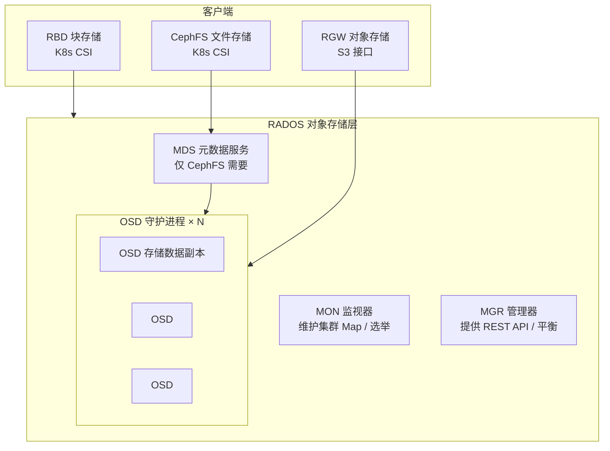
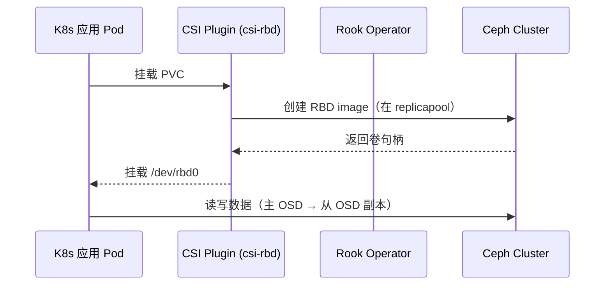

# Ceph 存储高阶原理、架构与运维指南（含 AutoOps 对接设计）

> 日期：2026-08-16　|　场景：AutoOps 3 节点测试集群（K8s v1.34.3 + Rook v1.14 + Ceph v18.2.0）

> 2026-10-01：迁移、备份恢复及高级维护已接入页面，见[维护中心说明](2026-10-01-ceph-maintenance.md)。下文保留基础架构说明。

## 目录
1. [Ceph 核心原理](#1-ceph-核心原理)
2. [当前场景架构整理](#2-当前场景架构整理)
3. [Ceph 运维指南](#3-ceph-运维指南)
4. [排障手册](#4-排障手册)
5. [AutoOps 存储管理对接设计](#5-autoops-存储管理对接设计)

---

## 1. Ceph 核心原理

### 1.1 总体架构

Ceph 是**统一分布式存储**系统，提供对象存储（RGW）、块存储（RBD）、文件存储（CephFS）三种接口，
底层都是**同一个 RADOS 对象存储层**。



### 1.2 核心组件

| 组件 | 全称 | 作用 | 故障影响 |
|------|------|------|----------|
| **MON** | Monitor | 维护集群状态图（Cluster Map：MON/OSD/PG Map），负责选举、认证 | 过半数丢失则集群不可写 |
| **OSD** | Object Storage Daemon | 实际存储数据，每盘一个 OSD 进程，负责数据副本、恢复、重平衡 | 少量 down 无影响，过多 down 触发降级 |
| **MGR** | Manager | 提供监控、Dashboard、均衡、碎片整理 | 挂了集群仍可用，功能降级 |
| **MDS** | Metadata Server | 仅 CephFS 需要，管理文件元数据 | CephFS 不可用，RBD 不受影响 |
| **RGW** | RADOS Gateway | 对象存储网关（S3/Swift API） | 仅对象存储受影响 |

### 1.3 数据分布机制（CRUSH + PG + 副本）—— 理解 Ceph 的关键

Ceph **不依赖中心元数据**，而是通过 **CRUSH 算法**把数据映射到 OSD。

```
数据对象(object)
   ↓ 哈希映射到
PG(Placement Group，放置组)   —— 逻辑容器，集群内固定数量（如 81 个）
   ↓ CRUSH 算法根据副本数(size)选出
OSD 列表（如 [osd.0, osd.1, osd.2]，三副本）
```

- **PG**：对象的逻辑分组，一个 PG 包含大量对象。PG 数量决定数据分布粒度。
- **副本 size**：每个对象保存几份。`size=3` 表示 3 份副本，允许 1 个 OSD 故障（min_size=2 保证可写）。
- **CRUSH rule**：决定副本如何分布。`failureDomain: host` 表示副本分散到**不同主机**（本集群配置）。
- **PG 状态**：active+clean 为健康；degraded（降级）、peering（对等）、backfilling（回填）、recovery（恢复）等表示异常/变化中。

**数据读写流程**：
```
客户端 → 计算 PG（hash 对象名）→ CRUSH 选出 OSD 主副本 → 主 OSD 写入并复制到从 OSD → 确认
```

### 1.4 存储接口

| 接口 | K8s 中 | 特点 | 本集群 StorageClass |
|------|--------|------|--------------------|
| **RBD** 块 | `rook-ceph.rbd.csi.ceph.com` | RWO，低延迟，适合数据库 | `rook-ceph-block` |
| **CephFS** 文件 | `rook-ceph.cephfs.csi.ceph.com` | RWX，共享文件，适合多副本应用 | `rook-cephfs` |
| **RGW** 对象 | - | S3 协议 | 未部署 |

### 1.5 Rook 如何管理 Ceph

Rook 把 Ceph 作为 K8s 原生资源管理：
- **Operator**：监听 `CephCluster` CR，自动创建/管理 MON、OSD、MGR、MDS 等
- **CRD 方式**：`CephCluster`、`CephBlockPool`、`CephFilesystem`、`CephObjectStore`
- **自愈**：组件崩溃自动重建；OSD 盘故障自动标记
- **运维接口**：通过 `rook-ceph-tools`（toolbox）执行 ceph 命令

---

## 2. 当前场景架构整理

### 2.1 部署架构（本集群）

```
┌─────────────┬─────────────┬─────────────┐
│  master-01  │  worker-01  │  worker-02  │
│  MON + OSD1 │  MON + OSD0 │  MON + OSD2 │
│  MGR + MDS  │             │             │
│  sdb 50G    │  sdb 50G    │  sdb 50G    │
│             │ (TopoLVM    │ (TopoLVM    │
│             │  sda 20G)   │  sdc 20G)   │
└─────────────┴─────────────┴─────────────┘
  MON×3 (quorum a,b,c)    OSD×3 (size=3, host 故障域)
```

### 2.2 资源清单（实测）

| 资源 | 值 |
|------|-----|
| Ceph 版本 | v18.2.0（Rook v1.14.0） |
| MON | 3（master-01/worker-01/worker-02） |
| OSD | 3（每节点 1 块 50G，size=3 三副本） |
| MGR / MDS | 各 1 |
| Pool | 4（replicapool、myfs-metadata、myfs-myfs-data0、.mgr） |
| PG 总数 | 81 |
| 状态 | **HEALTH_OK** |
| StorageClass | rook-ceph-block（RBD）、rook-cephfs（CephFS） |

### 2.3 数据流（以 K8s PVC 为例）



---

## 3. Ceph 运维指南

### 3.1 进入 ceph 命令行

```bash
# 使用 toolbox
kubectl -n rook-ceph apply -f https://raw.githubusercontent.com/rook/rook/v1.14.0/deploy/examples/toolbox.yaml
kubectl -n rook-ceph exec -it deploy/rook-ceph-tools -- bash
# 进入后：
ceph status          # 集群状态
ceph -s              # 同上
```

### 3.2 日常检查（巡检命令）

```bash
# 1. 集群健康
ceph status                  # health / mon / osd / pg
ceph health detail           # 健康详情（问题原因）

# 2. 容量
ceph df                      # 各 pool 用量（USED/AVAIL/RAW）
ceph osd df                  # 各 OSD 用量与均衡

# 3. OSD
ceph osd tree                # OSD 树（分布在哪些主机）
ceph osd status              # OSD 状态（up/down, in/out）

# 4. PG
ceph pg stat                 # PG 总数与状态统计
ceph pg dump_stuck           # 卡住的 PG（inactive/unclean/stale）

# 5. Pool
ceph osd pool ls detail      # pool 列表（含 size/min_size/pg_num）

# 6. 性能
ceph osd perf                # OSD 延迟
ceph daemon osd.0 perf dump  # 单个 OSD 性能
```

**AutoOps 界面操作**：存储管理页将提供图形化等价功能（见第 5 章）。

### 3.3 容量与扩容

**查看容量**：`ceph df` → RAW 总容量 / USED 使用 / 每 pool 用量。

**增加存储容量（加 OSD）**：
```bash
# 1. 在节点插入新盘（如 /dev/sde 100G）
# 2. 在 CephCluster CR 的 storage.nodes.<node>.devices 增加设备
#    （或 useAllDevices: true 自动接管所有空闲盘）
# 3. Rook 自动创建新 OSD 并 rebalance
kubectl -n rook-ceph patch cephcluster rook-ceph --type merge \
  -p '{"spec":{"storage":{"nodes":[{"name":"worker-01","devices":[{"name":"sdb"},{"name":"sde"}]}]}}}'
```

### 3.4 副本数管理（size）

**查看副本**：`ceph osd pool ls detail`（每 pool 的 size/min_size）

**调整副本数**（如 replicapool 从 3 改 2）：
```bash
# 方式一：ceph 命令
ceph osd pool set replicapool size 2
# 方式二：Rook CR（推荐，可持久化）
kubectl -n rook-ceph patch cephblockpool replicapool --type merge \
  -p '{"spec":{"replicated":{"size":2}}}'
```

> ⚠️ size 调整注意事项：
> - size 必须 ≤ 集群 OSD 数（本集群 3 → size 最大 3）
> - 提高 size 会触发数据复制，产生 backfill/recovery
> - min_size 建议 ≤ size-1（保证单 OSD 故障仍可写）

### 3.5 PG 数量管理

**查看**：`ceph osd pool get <pool> pg_num`

**调整**（新增 pool 或数据增长时）：
```bash
# 每 OSD 推荐 100~200 个 PG；PG 总数 = (OSD数 × 100) / 副本数
ceph osd pool set <pool> pg_num 64
ceph osd pool set <pool> pgp_num 64   # 须与 pg_num 一致或成比例
```

### 3.6 备份与恢复

- **RBD 快照**：`rbd snap create <pool>/<image>@<snap>`
- **RBD 导出**：`rbd export <pool>/<image> /backup/image.img`
- **CephFS 子卷快照**：`ceph fs subvolume snapshot create <fs> <subvolume> <snapshot> [--group_name <group>]`
- **整集群备份**：备份 `ceph config`、密钥环、`CephCluster` CR

---

## 4. 排障手册

### 4.1 常见告警与处理

| 现象 | 原因 | 处理 |
|------|------|------|
| `HEALTH_WARN` | PG 分布不均 / OSD 空间不足 / mon 时钟漂移 | `ceph health detail` 定位，针对性修复 |
| `HEALTH_ERR` | 数据不可用（如 PG inactive） | 紧急，见下方 PG 故障 |
| OSD down | 盘故障/进程崩溃 | `ceph osd tree` 确认，重启或替换 |
| `PG degraded` | 副本缺失 | 等待恢复或 `ceph pg repair <pgid>` |
| `PG inactive/peering` | 对等失败 | 检查网络/MON quorum |
| mon quorum 丢失 | 3 个 mon 挂 2+ | 需恢复 mon，最紧急场景 |
| 盘 IO 慢 | 单盘性能/坏道 | `ceph osd perf` 定位慢 OSD，考虑替换 |
| RBD 挂载失败 | image 未激活 / cephx 认证 | `rbd info` 检查，检查 secret |

### 4.2 关键排障命令

```bash
# 总体定位：先看 health detail
ceph health detail

# OSD 故障处理
ceph osd tree                              # 找 down 的 osd
ceph osd out <osd_id>                      # 标记 out（触发数据迁走）
ceph osd down <osd_id>                     # 标记 down
ceph osd safe-to-destroy <osd_id>          # 确认可销毁
ceph osd destroy <osd_id> --yes-i-really-mean-it
# Rook 管理的 OSD 应按 Rook 的 OSD 移除/替换流程处理 CR 和 Deployment。
# ceph orch osd rm 属于启用相应 orchestrator 后端的流程，不能直接假设适用于 Rook。
kubectl -n rook-ceph delete pod rook-ceph-osd-<id>-...  # 重启 OSD pod

# PG 故障
ceph pg dump_stuck                         # 卡住的 PG
ceph pg <pgid> query                       # 查看 PG 详情
ceph pg repair <pgid>                      # 尝试修复
ceph pg <pgid> debug unfound_objects_exist # 检查缺失对象

# MON 故障
kubectl -n rook-ceph logs deploy/rook-ceph-operator   # Rook 日志
ceph mon dump                             # mon 列表与地址
```

### 4.3 数据恢复（OSD 盘损坏场景）

```
1. ceph osd tree → 确认 osd.N down
2. ceph osd out osd.N → 触发数据迁到其他 OSD
3. 拔盘/换新盘，确认新盘裸盘
4. 更新 CephCluster CR（替换设备名），Rook 自动重建 OSD
5. ceph -s 观察 recovery/backfill 完成后 HEALTH_OK
```

### 4.4 日志与监控

```bash
# Rook 日志
kubectl -n rook-ceph logs deploy/rook-ceph-operator
# OSD 日志（容器内）
kubectl -n rook-ceph logs <osd-pod>
# Ceph 自身日志（节点）
tail -f /var/lib/rook/rook-ceph/ceph-osd/ceph-osd.*.log   # 各节点
# Ceph Dashboard（Web）
kubectl -n rook-ceph get svc rook-ceph-mgr-dashboard
# 密码
kubectl -n rook-ceph get secret rook-ceph-dashboard-password -o jsonpath='{.data.password}' | base64 -d
```

### 4.5 与 TopoLVM 的差异（便于理解 Ceph 特性）

| 维度 | TopoLVM（本地 LVM） | Ceph（分布式） |
|------|--------------------|----------------|
| 数据位置 | 单节点本地盘 | 分布式，副本跨节点 |
| 副本 | 无（1 份） | size=3（3 份） |
| 节点故障 | 数据丢失 | 数据仍可用 |
| 扩容 | 节点内 vgextend | 加 OSD 自动 rebalance |
| 场景 | 高 IO 单机 | 高可用分布式 |

---

## 5. AutoOps 存储管理对接设计

### 5.1 现有能力（已实现）

AutoOps K8s 存储管理模块当前支持：
- **PVC**：列表/详情/创建（界面+YAML）/扩容/克隆/迁移/换卷/删除
- **PV**：列表/详情/创建（界面+YAML）/删除
- **StorageClass**：列表/详情/创建/设默认/删除
- **存储统计**：总量/已用/可用/SC 列表

### 5.2 新增 Ceph 管理能力（本迭代实现）

| 功能 | 说明 | 实现方式 |
|------|------|----------|
| **集群状态卡片** | 健康状态（OK/WARN/ERR）、MON/MGR/OSD/PG 概览 | exec `ceph -s -f json` |
| **Pool 管理** | 列表（名称/size/min_size/PG/用量），创建/删除 | exec `ceph osd pool ls detail` + CR |
| **副本数调整** | 界面改 pool 的 size，自动刷新 | exec `ceph osd pool set <p> size <n>` |
| **OSD 状态** | 列表（ID/主机/状态/权重/容量），down 高亮 | exec `ceph osd tree/df` |
| **容量概览** | 总容量/已用/可用/各 pool 用量 | exec `ceph df` |
| **Dashboard 入口** | 跳转 Ceph Dashboard | Service 地址 |

### 5.3 API 设计

```
GET  /k8s/cluster/:id/ceph/status      # 集群健康 + 容量 + OSD 概览
GET  /k8s/cluster/:id/ceph/pools       # pool 列表（含副本 size）
PUT  /k8s/cluster/:id/ceph/pools/:poolName/size   # 调整副本数 {size: n}
GET  /k8s/cluster/:id/ceph/osds        # OSD 状态列表
```

> 后端通过 exec 到 `rook-ceph-tools` pod 执行 ceph 命令（自动发现该 pod），
> 无需在 Ceph 节点装额外工具。

### 5.4 界面操作指南（实现后）

1. **存储管理 → Ceph tab**：顶部健康状态卡片（绿色 OK/红色 ERR）
2. **Pools 表格**：展示每个 pool 的副本数，点"调整副本"改 size
3. **OSD 表格**：展示每块盘状态，down 的红色标记
4. **容量**：总容量/使用率进度条
5. 结合 AutoOps 告警模块，可对 Ceph 健康状态做监控告警

### 5.5 当前扩展状态（2026-10-01）

- 已接入 CephFS 子卷、配额、快照及克隆。
- 已接入 RGW 用户状态、配额和桶用量查询。
- 已接入 RBD 分阶段迁移、持久化全量/增量备份恢复及定时计划。
- 已接入 OSD/PG 维护动作和任务记录。
- RGW 网关部署、物理盘接入和 Ceph 告警规则自动创建仍需按对应组件部署文档实施。

---

## 附：常用 ceph 命令速查

```bash
ceph -s                                  # 状态总览
ceph status                              # 同上
ceph health detail                       # 健康详情
ceph df                                  # 容量
ceph osd tree                            # OSD 拓扑
ceph osd pool ls detail                  # pool 详情
ceph osd pool set <p> size <n>           # 改副本数
ceph pg stat                             # PG 统计
ceph pg dump_stuck                       # 卡住的 PG
ceph pg repair <pgid>                    # 修复 PG
ceph mon dump                            # MON 列表
ceph auth ls                             # 认证密钥
rbd ls <pool>                            # 列出 RBD 镜像
ceph fs ls                               # 列出 CephFS
```

**相关文件**：`k8s/storage/ceph-rook/rook-ceph-deploy.yaml`、`docs/2026-08-16-ceph-minimal.md`
