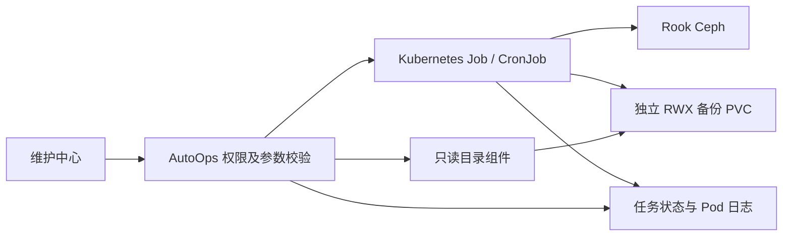

# Ceph 存储维护中心

入口：**K8s → 存储管理 → Ceph 存储 → 维护中心**。

原有“概览与资源”保留 Pool、RBD 镜像、快照、CephFS、OSD 和健康诊断。维护中心增加跨池迁移、持久化备份及恢复、定时计划和高级维护操作。

实现针对项目现有 `rook-ceph` 命名空间、Ceph Reef 和 Rook 部署。任务使用集群中 `app=rook-ceph-tools` 就绪 Pod 的镜像，需要镜像包含 `python3`、`bash`、`ceph`、`rbd`；对象存储功能另需 `radosgw-admin` 和已部署的 RGW。定时计划使用 `batch/v1` CronJob 和 `spec.timeZone`，建议 Kubernetes 1.27 及以上。

## 1. 功能范围

| 分类 | 已接入的操作 | 完成后的检查 |
|---|---|---|
| RBD 复制 | 从快照复制到新镜像、包含快照的 deep copy、flatten | 比较数据，再接入业务 |
| RBD 迁移 | prepare、execute、commit、abort，查看迁移状态 | execute 完成后验证；commit 删除源数据 |
| RBD 快照 | 原有创建/删除/回滚/克隆，新增保护/取消保护、定时快照、克隆依赖查询 | 快照具有一致性和依赖关系要求 |
| 备份 | 全量基线、增量、SHA-256 校验、备份目录、无后继备份删除 | 校验备份链并定期恢复演练 |
| 恢复 | 校验整条链后恢复到新 RBD 镜像 | 文件系统和应用级校验 |
| 定时维护 | 定时全量备份/快照，指定时区，暂停、恢复、删除计划 | 检查计划上次成功时间和仓库容量 |
| CephFS | 子卷创建/配额调整/删除、快照创建/删除/克隆 | 克隆任务持续等待 Ceph 的完成状态 |
| OSD/PG | scrub/deep-scrub、PG repair、维护标志、balancer 开关、PG autoscale | 命令受理后继续观察集群状态 |
| RGW | 用户/桶列表及详情、桶用量、暂停/启用用户、用户/桶配额 | 用户密钥从响应和任务日志中移除 |
| 高级诊断 | OSD 拓扑/延迟/标志、卡住的 PG、RBD 回收站与镜像复制状态、CephFS 子卷组/详情/克隆进度 | 缺失组件或权限时显示实际错误 |

Pool 配额表单仅提交勾选的字段，未勾选的限额保持不变；勾选后填 0 才会解除该项限制。

本模块不创建 RGW 对象网关或远端镜像复制 peer，也不执行物理磁盘初始化、任意 Ceph 命令、跨集群在线 RBD 迁移、S3 直接上传或应用停写脚本。Rook CR 管理的资源仍应由对应 CR 持久化期望状态，避免 Operator 将直接 CLI 调整还原。

## 2. 执行和权限



### AutoOps 用户权限

- 具有启用状态 `admin` 角色的系统管理员可执行维护；停用角色不提供管理员权限。
- 普通用户需要 `rook-ceph` 命名空间的传统权限：`readonly` 可查看，`write/admin` 可维护。
- 精细 RBAC 可授予 `apiGroups: ["autoops.io"]`、`resources: ["cephmaintenance"]`，`verbs: ["get"]` 用于查看，`verbs: ["get", "update"]` 用于维护。
- 这里只授予其他业务命名空间的权限，不会获得底层 Ceph 访问权。
- `cephmaintenance/update` 包括删除、回滚和迁移提交等存储维护权限；页面对高风险任务要求再次输入操作标识。
- 原有 Ceph 接口也使用相同读写权限检查，防止只读用户绕过按钮直接调用写接口。

### AutoOps 使用的 Kubernetes 凭据

需要读取/执行 toolbox、读取日志、创建 Job/CronJob、管理仓库 ConfigMap 和只读目录 Deployment。参考 [autoops-maintenance.yaml](../k8s/storage/ceph-rook/autoops-maintenance.yaml) 中的 Role。

该 Role 只覆盖 Ceph 维护所需能力，不覆盖 AutoOps 其他 K8s 页面。实际 API 使用的是在 AutoOps 集群管理中登记的 kubeconfig；仅创建示例 ServiceAccount 不会自动替换现有 kubeconfig。

Job 引用 `rook-ceph-mon` Secret 和 `rook-ceph-mon-endpoints` ConfigMap，init container 生成临时 Ceph 配置。任务不挂载 Kubernetes ServiceAccount token，不把 Ceph 密钥存入任务参数。目录读取组件只读挂载备份 PVC，不挂载 Ceph 凭据。

### 任务语义

- 手动任务和定时任务都由 Kubernetes 执行，页面关闭、API 重启不影响已提交任务。
- 默认超时 6 小时；API 接受 60 秒至 7 天，页面可选 1–168 小时。
- `backoffLimit=0`，失败不自动重试，避免重复执行有副作用的操作。
- 任务记录包含操作者、参数、创建/启动及成功完成时间（如有）、状态和错误；日志页显示最近 1000 行，最多 256 KiB，并显示容器及调度状态。
- 取消通过暂停 Job 停止 Pod，保留 Job 记录；不会回滚已完成的写入。CephFS 克隆等提交给 Ceph 服务端的工作可能继续，应查看克隆状态后处理。
- 不同手动任务没有全局互斥。对同一镜像的迁移、回滚、扩缩容等维护应串行安排。备份仓库中的备份、校验、删除及恢复由文件锁串行执行。
- scrub、PG repair、OSD 标志等任务成功表示命令执行成功，不代表集群已恢复健康。

## 3. 准备备份仓库

备份默认落到专用的持久化 PVC。推荐独立 NFS 或其他独立故障域的共享文件系统。

1. 准备提供 `ReadWriteMany` 的存储类，例如 `backup-nfs`。
2. 修改示例中的存储类及容量，再创建 PVC：

   ```bash
   kubectl apply -f k8s/storage/ceph-rook/autoops-maintenance.yaml
   kubectl -n rook-ceph get pvc autoops-ceph-backups
   ```

3. PVC 必须位于 `rook-ceph`，使用 `Filesystem`，包含标签 `autoops.io/ceph-backup=true`。已有 PVC 可这样标记：

   ```bash
   kubectl -n rook-ceph label pvc autoops-ceph-backups autoops.io/ceph-backup=true
   ```

4. 确认文件系统允许任务容器的运行用户写入，并支持跨节点共享文件锁。NFS 的 `root_squash`、目录 UID/GID 和权限需由存储管理员配置。
5. 页面进入“备份仓库 → 登记仓库”，填写仓库名 `nfs-backup` 和 PVC 名 `autoops-ceph-backups`。
6. 系统创建仓库 ConfigMap 和目录读取 Deployment。首次加载目录前等待 Pod 就绪；镜像拉取、PVC Pending 或挂载失败会显示错误。

登记失败后可用相同仓库名和 PVC 重试，以修复未创建的目录 Deployment。已有仓库名不能指向其他 PVC。

使用同一 Ceph 集群的 CephFS PVC 可以验证流程，但它与源卷共用故障域，无法覆盖整个 Ceph 集群丢失的场景。原有 RBD/RWO PVC 不适合作为此共享仓库。

## 4. 全量、增量和恢复

### 4.1 全量备份

选择“维护操作 → 全量备份”，填写 Pool、镜像和仓库，提交后到任务记录查看日志。

执行顺序：

1. 创建 `autoops-<任务编号>` 快照。
2. 对该快照执行不带 `--from-snap` 的 `rbd export-diff`，形成完整基线。
3. 写入临时文件，计算 SHA-256 并刷盘。
4. 发布 `<任务编号>.diff` 和 `<任务编号>.json` 清单。清单发布后才出现在可用备份目录。

清单保存源集群 FSID、Pool、镜像、快照、父备份编号、镜像逻辑大小、文件大小、校验和及 UTC 创建时间。页面时间显示为上海时区。

导出失败可能留下 `.partial` 文件和源快照，便于排查。任务不会把未完成文件标记为可用备份，也不会自动重试或删除源快照。

### 4.2 增量备份

在“备份仓库”选择一条备份并点击“增量”。该备份可以是全量，也可以是上一份增量。

- 系统核对父备份链、校验和以及集群 FSID/源镜像。
- 父备份的源快照必须仍然存在。
- 创建新的结束快照，通过 `rbd export-diff --from-snap <父快照>` 导出变化。
- 后续恢复需要从全量到所选增量的每一个文件及清单。删除任意中间文件都会破坏链。

同一全量可以产生多个分支增量。系统按明确的父编号恢复，避免根据文件名或时间猜测顺序。

### 4.3 校验和恢复

1. 先选择备份执行“校验”：检查清单、链连续性、文件完整性和所有 SHA-256。
2. 选择“恢复”，填写**新的目标 Pool/镜像名**。
3. 系统再次验证整条链，再创建目标镜像并按顺序 `rbd import-diff`。
4. 确认镜像逻辑大小后，任务才成功。业务管理员应再执行文件系统检查、数据库恢复检查或文件抽检。

目标已存在时拒绝恢复；不会覆盖现有镜像。导入过程中失败会保留未完成的新镜像，检查后应换一个目标名重试，或手动清理该目标。恢复不会自动创建 PVC、修改工作负载或切换业务。

数据库的普通存储快照通常只有崩溃一致性。备份前需由应用停写、刷盘或使用数据库备份机制；本模块不会自行登录数据库执行停写。

### 4.4 删除与保留

只能删除没有增量后继的备份；先删增量链的叶子，再删父备份。删除备份文件不会删除源快照。确认没有增量任务需要这些快照后，再在 RBD 快照管理中处理。

定时计划默认保留最近 10 个成功和 10 个失败 Job 记录，但**不会清理备份文件或快照**。目录直接读取 PVC 清单，不依赖 Job 历史。请按容量与保留要求定期清理备份链、源快照及失败临时文件，并把仓库自身纳入备份。

## 5. 数据迁移

### 从快照跨池复制

适用于需要保留源数据、创建独立目标的场景：

1. 在业务一致性窗口创建源快照。
2. 选择“从快照跨池复制”，填写源 Pool/镜像/快照和新的目标 Pool/镜像。
3. 任务执行 `rbd cp`。目标必须不存在，目标 Pool 应已初始化 RBD。
4. 验证复制结果，再配置客户端或静态卷接入目标。源镜像及快照保留。

需要同时复制全部快照时使用“复制镜像及全部快照”，先停止业务并卸载源镜像。后端检查 watchers，但这不能阻止其他客户端在检查后重新挂载；维护窗口仍需保持停写。

### 原生 RBD 分阶段迁移

| 阶段 | 表单中的 Pool/镜像 | 行为 |
|---|---|---|
| 准备 | 源镜像，另填新目标 | 卸载源卷后执行 prepare；源变为目标的父数据源 |
| 执行 | 目标镜像 | execute 复制数据；可在诊断中查看迁移状态 |
| 提交 | 目标镜像 | 仅允许 executed 状态，验证并卸载后 commit，源数据被删除 |
| 中止 | 目标镜像 | 卸载后 abort，目标侧变化丢失，恢复源镜像 |

`csi-vol-*` 镜像禁止直接进行该迁移流程，因为 CSI 元数据和 PV 句柄不会随 CLI 迁移自动更新。K8s 应用卷应使用原有“PVC 迁移/换卷”流程。新镜像不会自动替换工作负载引用。

## 6. CephFS、RGW 和集群维护

### CephFS

先在高级诊断查询文件系统下的子卷组、子卷、配额及快照。表单中的子卷组可留空，表示默认组。创建子卷组本身仍由 Ceph 管理员完成。

子卷配额使用 GiB，调整时启用 `--no_shrink`，防止低于当前已用量。克隆到同一子卷组中的新子卷，后台查询 `ceph fs clone status`，直到 `complete` 才成功。CSI 子卷的生命周期和容量通过 PVC 管理。

### RGW

查询用户、桶及用量，执行用户暂停/启用和配额设置。用户配额作用于用户总量；桶配额作用于该用户的每个桶。界面不显示 access key、secret key、Swift key 等凭据。

### OSD/PG

- 短期节点维护可使用 `noout`；维护完必须解除。不会自动设置其他停止恢复的标志。
- `norecover/nobackfill/norebalance` 会影响数据恢复，应结合健康诊断使用。
- OSD `out` 后等待数据迁移，移除前执行 `safe-to-destroy`。原有 OSD purge 接口已增加该前置检查。
- `PG repair` 只应在定位不一致原因后使用，不能作为所有 degraded/peering 问题的通用修复。
- Pool 的 autoscale 调整会直接写 Ceph。Rook 管理的池应同步修改对应 `CephBlockPool.spec.parameters`。

## 7. API 与实现位置

基础路径：`/api/v1/k8s/cluster/:id/ceph/maintenance`。

| 方法 | 路径 | 用途 |
|---|---|---|
| GET | `/capabilities` | 操作定义、表单字段、当前用户写权限 |
| GET | `/inspect?kind=...` | 固定诊断命令 |
| GET / POST | `/tasks` | 列出/提交任务 |
| GET | `/tasks/:name/logs` | 任务状态、Pod 状态和日志 |
| POST | `/tasks/:name/cancel` | 停止任务 Pod，保留记录 |
| GET / POST | `/repositories` | 列出/登记仓库 |
| GET | `/backups?repository=...` | 读取仓库清单 |
| GET / POST | `/schedules` | 列出/创建计划 |
| PUT | `/schedules/:name` | `{ "suspended": true/false }` |
| DELETE | `/schedules/:name` | 删除计划，保留已有任务 |

提交任务示例：

```json
{
  "operation": "backup-full",
  "params": {"pool": "replicapool", "image": "mydisk", "repository": "nfs-backup"},
  "timeoutSeconds": 21600,
  "confirmation": ""
}
```

危险操作的 `confirmation` 必须等于 `operation`，例如 `rbd-migration-commit`。接口仅接受能力目录中的字段和值，不提供任意 shell 或命令入口。

主要实现：

- 后端：`api/api/k8s/service/k8sceph.go`、`ceph_catalog.go`、`ceph/worker.py`。
- 权限：`api/middleware/cephPermission.go`。
- 前端：`web/src/views/K8s/ceph/CephMaintenance.vue`、`web/src/api/ceph.ts`。
- 原有接口加固：`k8sstorage.go`、`ceph_safety.go`。

## 8. 上线验收

本地回归命令：

```bash
# Go：参数校验、Job 启动、取消状态、脱敏和权限隔离
cd api
go test ./api/k8s/service ./middleware -run Ceph -count=1

# 返回仓库根目录：模拟备份、损坏链、恢复和删除
cd ..
python3 -B -m unittest discover -s api/api/k8s/service/ceph -p 'test_*.py' -v
```

Go 测试使用临时 SQLite 和本地进程；Python 测试使用模拟 RBD 和临时目录，不连接 Ceph。前端可通过 `cd web && pnpm build` 验证生产构建。

代码验证不替代真实集群验收。建议在测试 Pool 上依次执行：

1. 只读用户读取列表，直接调用任务 POST 被拒绝；其他业务 namespace 用户不能访问 Ceph。
2. 写入测试文件，全量备份；修改文件，再创建增量。
3. 校验并恢复到新镜像，挂载后检查文件内容。
4. 人为复制一套备份测试损坏/缺失场景，确认恢复在创建镜像之前失败。
5. 跨池复制并检查数据，测试原生迁移 prepare/execute/abort 和另一组 prepare/execute/commit。
6. 创建定时计划，检查时区、任务记录、暂停及删除行为。
7. 模拟 toolbox 不就绪、PVC Pending、仓库写入权限不足及 RGW 未安装，确认页面能呈现错误。

官方语义参考：[Ceph Reef RBD 命令](https://docs.ceph.com/en/reef/man/8/rbd/)、[CephFS 子卷与克隆](https://docs.ceph.com/en/reef/cephfs/fs-volumes/)、[RGW 用户与配额](https://docs.ceph.com/en/reef/radosgw/admin/)、[Rook toolbox Job 示例](https://github.com/rook/rook/blob/v1.14.0/deploy/examples/toolbox-job.yaml)。
