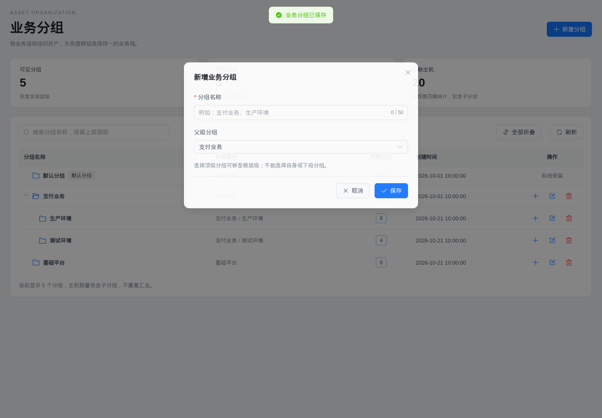
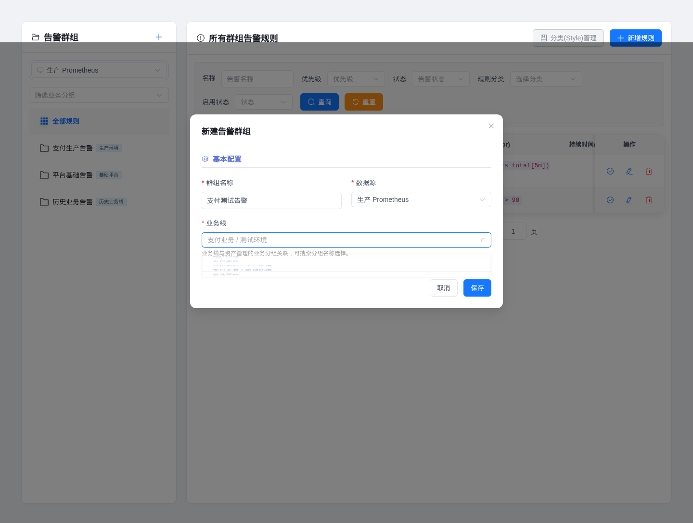

# 告警业务分组与操作按钮调整

## 界面行为

- 容器工作负载的弹性伸缩、编辑 YAML、更多操作使用图标按钮，悬浮显示操作名称。保持 32px 点击区域、原有禁用条件和更多操作菜单。
- 告警配置中的规则检查、编辑、删除，以及群组和分类的行内操作使用相同的图标按钮和悬浮提示。
- 告警群组新建、编辑不再提供 YAML 定义。业务线从资产管理的业务分组中选择，支持按名称搜索，并显示父级路径。加载失败时可重试，无可选分组时提示创建或获取授权。
- 资产业务分组页面提供层级树表、路径、关联主机数、搜索、展开/折叠、新建子分组和父级调整。统计仅汇总顶级分组的主机数，避免对子分组重复累加。默认分组保留且不可编辑、删除。

## 接口与数据

新增 `GET /api/v1/monitor/alert/business-groups`，仅返回业务分组 `id`、`parentId`、`name` 元数据。此接口沿用监控模块权限，并按当前用户的资产分组 `get` 权限筛选；不会因为可以管理监控就暴露全部资产分组。群组创建和编辑也在服务端验证所选分组的访问权限和有效性。

告警群组保存字段为 `group_name`、`data_source_id`、`cmdb_group_id`，编辑时包含 `id`。`monitor_alert_group_rule.cmdb_group_id` 关联 `cmdb_group.id`。`labels.cluster` 仍记录选择时的业务分组名称，以兼容已有规则标签逻辑。

规则列表查询增加 `dataSourceId`、`cmdbGroupId`。过滤发生在数据库计数和分页之前；前端快速切换条件时丢弃过期响应。

群组编辑只修改元数据并从现有子规则生成内部 YAML，保留下属规则 ID、状态、启用标记、分类及其他群组标签。禁用规则不写入生成的 YAML，但保留在数据库中。数据源仍不可通过群组编辑切换。

业务分组保存校验空白名称、50 字符限制、重名、父级存在性及层级循环。更新显式保存 `parent_id=0`，支持移回顶级。包含子分组、主机、数据库或告警群组引用时不能删除，服务端返回具体原因。

## 升级

重新构建前端并重启后端。已注册的 GORM AutoMigrate 会为现有告警群组表添加 `cmdb_group_id` 和索引；初始化 SQL 同步包含该字段，不需要手工修改已有记录。

旧群组的 `cmdb_group_id` 默认为 0，继续显示原业务线标签和运行原规则。编辑时由用户选择实际业务分组，不按名称自动猜测或批量改写历史关系。业务分组重命名后界面按关联 ID 显示新名称；兼容标签在下次编辑保存告警群组时更新。

## 验证

- `go test ./api/monitor/... ./api/cmdb/dao ./api/cmdb/service ./api/cmdb/controller ./router/...` 通过。
- 新增数据库回归用例覆盖业务分组权限、授权撤销、群组元数据更新保留规则状态、关联筛选及分页、父级调整、循环层级和引用删除保护。
- `pnpm build`、目标页面 ESLint、国际化静态扫描、Chromium 隔离数据交互检查通过。浏览器覆盖 32px 图标按钮悬浮提示和菜单、业务分组搜索与父级调整、告警群组保存载荷、旧群组重新关联、业务线筛选、失败重试、深色主题及 390px 窄屏布局，无页面脚本错误。
- 浏览器使用实际页面组件和模拟 API 返回，不连接真实业务环境；数据库用例使用临时 SQLite 数据库。
- 全量 `vue-tsc` 仍受仓库现有类型问题阻塞：默认命令的 `ignoreDeprecations` 配置不兼容，使用 `--ignoreDeprecations 5.0` 后仍有 `src/api/cmdb.ts`、`src/utils/sseLogManager.ts` 等既有错误。本次两个页面没有新增类型报错。

## 界面预览

以下截图使用隔离演示数据。

## 工作负载“更多操作”点击修正

工作负载行内菜单改用 `web/src/components/ActionDropdown.vue`。按钮直接作为下拉菜单触发器；悬浮提示使用同级的虚拟触发节点，不再包裹下拉组件。菜单展开期间隐藏提示，提示层不接收鼠标，也不处理菜单的 Enter/Space 按键。菜单挂载到 body，避免被表格固定列裁切；Escape 可以关闭菜单。

本次仅修正前端触发和焦点处理，原有扩缩容、重启、回滚、配置、调度和删除命令继续使用既有 API 与禁用条件，没有接口或数据库变更。

使用实际页面、应用组件注册方式和全局样式进行了 Chromium 检查：悬浮后单击、反复开关、移出按钮、点击空白关闭、Enter/Space/Escape、不同工作负载间切换、所有菜单项打开正确弹窗，以及扩缩容仅提交一次且携带所选工作负载。接口使用隔离模拟数据，未操作真实集群。新组件 ESLint、格式检查和前端构建通过。
