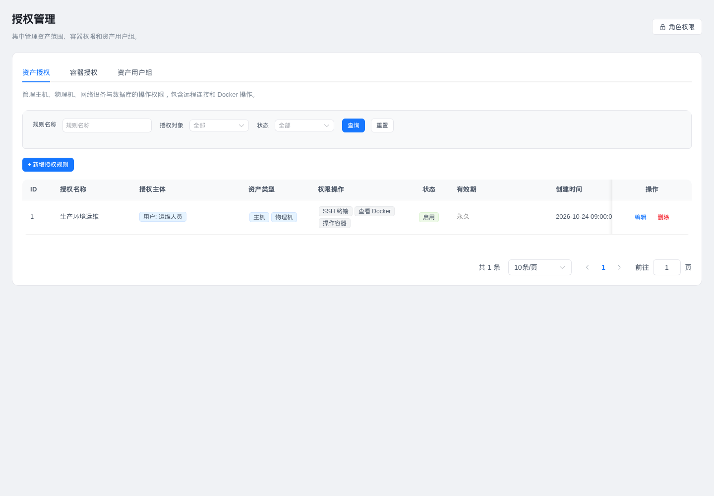
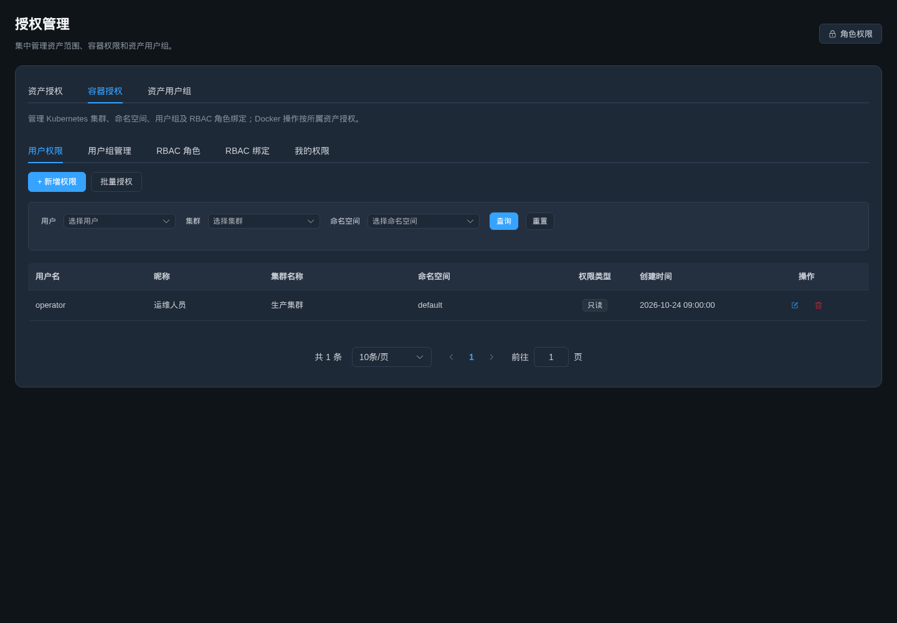
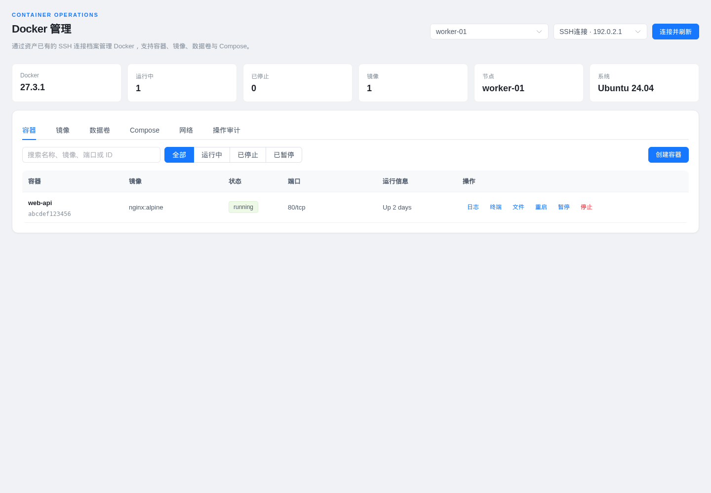
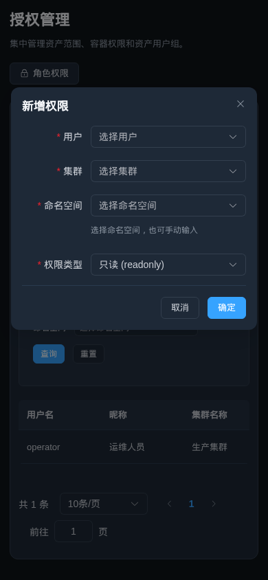

# 导航、统一授权和公共界面规范

## 页面入口

| 位置 | 地址 | 内容 |
| --- | --- | --- |
| 容器管理 → Docker管理 | `/k8s/docker` | Docker 资产发现、容器、镜像、网络、数据卷和 Compose |
| 基础管理 → 授权管理 → 资产授权 | `/system/authorization?tab=assets` | 资产范围、协议、Docker、数据库及配置操作授权 |
| 基础管理 → 授权管理 → 容器授权 | `/system/authorization?tab=containers` | Kubernetes 用户/用户组权限、RBAC 角色及绑定 |
| 基础管理 → 授权管理 → 用户组 | `/system/authorization?tab=groups` | 资产/容器用户组与成员维护 |

原有 Docker、资产授权、容器授权、资产用户组和凭据授权地址保留隐藏重定向。Docker 终端旧链接保留资产、容器与查询参数。统一授权页面复用现有真实 API，按页签加载，不使用演示数据。Kubernetes 用户组仍遵循原有权限模型，不与资产用户组合并数据。

## 授权行为

- 独立凭据授权页面、前端接口和后端 `/cmdb/permission/credential*` 路由已移除。历史表及数据兼容保留，原有凭据授权记录不再决定操作权限。
- 远程连接、Docker、任务执行、AI Docker 工具、网络配置及数据库操作按目标资产与具体动作校验；活动账户、授权有效期、连接启用状态、只读限制、审计和会话期间撤权检查继续生效。
- 连接档案配置及凭据枚举由活动管理员执行；新增主机 SSH 绑定、修改 SSH 地址/用户名/端口/凭据以及数据库账号新绑定同样需要管理员。普通资产操作人员使用已配置连接；主机可先登记，再由管理员配置连接。相应表单同步隐藏或禁用管理员配置项。
- Docker 页面仍使用 `/cmdb/docker/...` API。新增 `GET /cmdb/docker/targets` 和 `GET /cmdb/docker/assets/:assetType/:assetId/connections`，使只有 Docker 模块权限及对应资产 `docker_view` 权限的用户可以发现目标，不再依赖 CMDB 资产列表权限或 `connect_ssh`。
- 系统角色的模块权限与资产/Kubernetes 范围权限共同生效；统一入口没有放宽授权管理的管理员限制。

## 公共样式

`web/src/style/design-system.css` 集中维护按钮、筛选区、输入控件、卡片、表格、弹窗、页面留白与深浅主题状态色，并覆盖旧页面相互冲突的局部样式。默认/小号/大号按钮高度为 36/32/44px，控件圆角 6px，面板和弹窗圆角 12px。表格操作统一轻量显示，删除保持红色。

页面布局统一为桌面 24px、窄屏 14px 留白；终端和远程桌面通过 `uiLayout: "canvas"` 保持独立布局。窄屏表格使用内部横向滚动，操作列取消固定，弹窗限制在视口内。部分任务、应用发布、工作流与节点监控原生操作按钮已接入 Element Plus，复用同一规范。

## 升级与验证

后端启动自动调用 `api/pkg/db/navigation_migrate.go`，将数据库 Docker 菜单移入容器管理、合并授权入口并停用重复旧菜单；保留原菜单 ID、已有权限值和历史角色关系。`api/sql/autoops.sql` 同步新安装菜单。无需增加 Docker Compose 或 Kubernetes 环境变量。

本次未连接或修改运行中的业务数据库，未执行真实主机/容器操作。更新后需重新构建前端并重启后端，才会应用样式、API 和菜单迁移。

验证命令：

```bash
cd api
go test ./api/cmdb/... ./api/aiops/service/... ./api/task/service/... ./middleware/... ./pkg/db/... ./pkg/authorization/... ./router/cmdb/...
cd ../web
node scripts/navigation-check.cjs
pnpm i18n:test
pnpm build
```

新增/更新测试覆盖旧链接重定向、Docker 独立模块菜单、资产撤权、跨资产连接拒绝、普通用户不能重新绑定凭据、Docker 目标范围、凭据接口移除和菜单迁移幂等性。浏览器检查使用真实 Vue 组件和隔离 API 样本，覆盖三个授权页签、成员与新建弹窗、Docker 数据加载、旧节点按钮、深浅主题及 390px 窄屏，未出现浏览器错误。

以下截图使用隔离测试数据：






后续 Key 权限与用户组整合见 [API Key 独立权限](2026-10-24-api-key-scopes-user-groups.md)。
