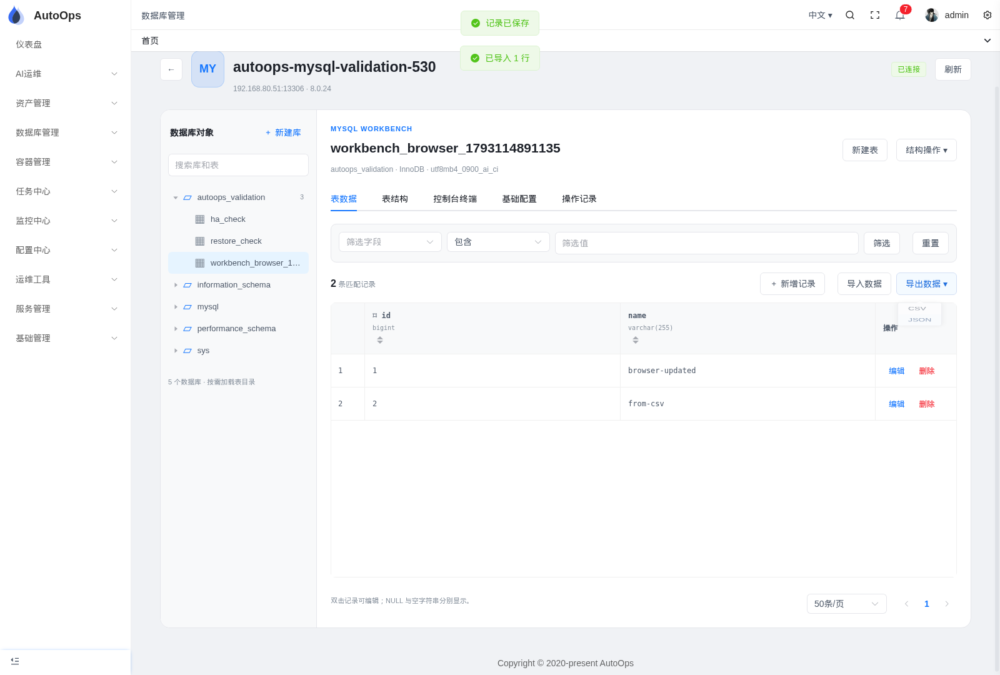
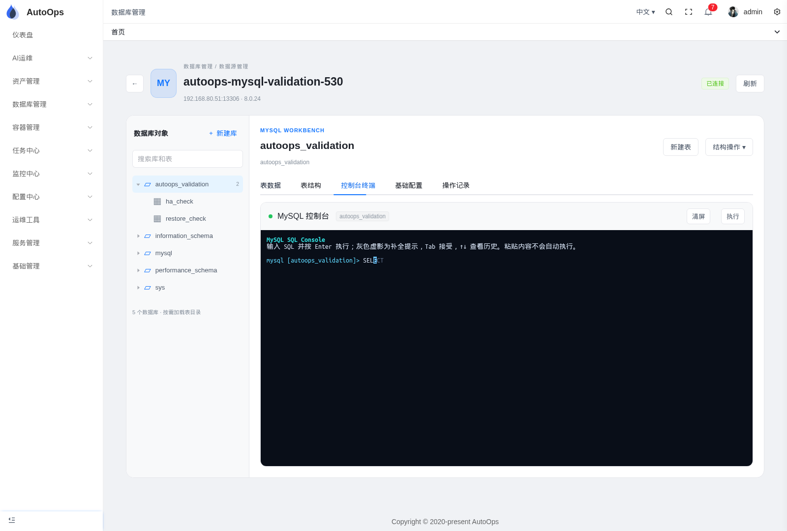

# 数据源管理与 MySQL 可视化工作台

## 入口与业务分组

主菜单新增 **数据库管理**，第一个子菜单为 **数据源管理**（`/database/sources`）。原资产管理下的数据管理已迁移，旧地址 `/cmdb/db`、`/cmdb/dbdetails?id=…` 自动跳转并保留查询参数。菜单迁移保留已有数据源菜单 ID、按钮权限和角色关联，并给对应角色补齐新父菜单。

数据源继续使用 CMDB 的业务分组，支持 MySQL、PostgreSQL、Redis。名称模糊搜索、数据库类型、业务分组可以组合使用；选择父分组包含其子分组，后端先做资产授权过滤，再统计与分页。列表展示分组、地址、用户名，不返回账号密码。非管理员的分组树仅包含已授权数据源的分组及其祖先。

数据源页及工作台不展示“数据库部署与高可用”。已有安装、备份和 Orchestrator 功能保留在 **运维工具 → 工具列表 → 数据库 Ansible 部署**，详见 [数据库自动化说明](2026-10-27-database-automation.md)。

## MySQL 工作台

进入数据源后，左侧按需加载数据库和表目录，右侧显示表数据、表结构、控制台终端、基础配置和操作记录。

| 功能 | 行为 |
| --- | --- |
| 库表浏览 | 搜索目录，查看引擎、字符集、字段、主键、索引和 CREATE TABLE 定义 |
| 表数据 | 分页、字段筛选、排序，区分 NULL 与空字符串；BIGINT、DECIMAL 以文本传输以保留精度 |
| 记录操作 | 新增、编辑、删除；编辑和删除要求完整主键并比较原始记录，发生并发修改时拒绝覆盖 |
| 表结构操作 | 可视化新建数据库、新建表、修改数据库默认字符集、删除表 |
| 控制台终端 | 使用与容器终端相同的 xterm；在输入末尾用淡色虚影显示关键字、表名和字段名补全，Tab 接受，↑↓ 历史，Ctrl+L 清屏，Ctrl+C 清除输入；不显示右侧提示栏 |
| 基础配置 | 展示连接信息；管理员可修改最大连接数、连接超时、慢查询阈值及慢日志开关 |
| 操作记录 | 按数据源查询已有审计；写操作和导入导出包含动作、目标和执行结果 |

控制台按 Enter 执行单条 SQL，支持只读查询及 INSERT/UPDATE/DELETE；`USE` 切换工作台数据库上下文。每条 SQL 使用独立连接，不保持事务、临时表或会话变量。粘贴多行不会自动执行，切换工作台标签保留当前终端输出和历史。UPDATE/DELETE 必须包含 WHERE，字符串或注释中的 WHERE 不算条件；字符串中的分号可正常使用。

输入末尾的淡灰色文字仅为补全预览，按 Tab 后才加入命令；直接按 Enter 不会提交未接受的虚影。光标移到输入中间时隐藏预览，退格后重新计算匹配内容。

可视化行操作和导入面向业务库的 InnoDB 基表。系统库、视图、非 InnoDB 表不提供可视化写入；无主键表仍可新增，但不能通过网格编辑或删除单行。二进制字段以十六进制查看，当前不支持直接编辑和导入；生成字段只读，导入时忽略文件中提供的生成值，由 MySQL 重新计算。

全局参数修改只影响运行时，不写配置文件或 `SET PERSIST`。结构操作具有 MySQL 的隐式提交行为，界面在执行前独立确认。[MySQL 隐式提交说明](https://dev.mysql.com/doc/refman/8.0/en/implicit-commit.html)、[服务器变量说明](https://dev.mysql.com/doc/refman/8.0/en/server-system-variables.html)。





表数据截图使用隔离临时表，已在验证后清理。

## 导入与导出

- 导入支持 UTF-8 CSV、JSON，单文件不超过 8 MiB、1–10000 条记录；使用一个事务插入，任一行失败则本次全部回滚。
- CSV 第一行为字段名，`\N` 表示 NULL；以反斜杠开头的普通文本需要再增加一个反斜杠。引号、换行、逗号按标准 CSV 转义。JSON 为记录对象数组，`null` 表示 NULL。
- 可以省略有默认值或自增的字段；导入不会覆盖重复主键，也不接受 SQL dump。
- 导出按当前字段筛选与排序获取所有匹配行，不局限于当前分页。单次最多 10000 行，读取结果上限 8 MiB，超出时要求缩小筛选范围；不会静默导出部分结果。
- 表数据每页最多 500 行。终端查询最多显示 500 行，并明确提示截断。

例如：

```csv
name,description
example,\N
```

```json
[{ "name": "example", "description": null }]
```

## 授权与 API

数据库菜单使用平台 `database:read` 权限。查询还需要目标资产 `db_query`，写入需要平台 `database:execute` 和目标资产 `db_execute`，审计需要对应审计权限。修改全局参数仅管理员可用。写入、导入和结构变更均要求完整数据源名称确认；只读实例在界面隐藏写入入口，数据库服务端仍执行实际账号和只读状态检查。

新增 API 前缀 `/api/v1/cmdb/databases/:id/mysql`：

| 方法 | 路径 | 用途 |
| --- | --- | --- |
| GET | `/capabilities` | 当前数据源操作能力 |
| GET | `/table` | 字段、主键、索引、建表语句 |
| GET | `/data` | 带分页、筛选与排序的数据 |
| POST | `/rows` | 参数化单行新增、编辑、删除 |
| GET | `/export` | CSV/JSON 导出 |
| POST | `/import` | multipart CSV/JSON 导入 |
| POST | `/schema` | 结构化库表操作 |
| GET / PUT | `/variables` | 查询 / 修改允许的运行时参数 |

`GET /api/v1/cmdb/database-groups` 返回有权限的数据源业务分组树。`GET /api/v1/cmdb/databaselist` 支持 `name`、`type`、`groupId`、`page`、`pageSize` 组合条件。SQL、概览、库表目录、Redis 和审计沿用既有 API。

## 部署

无需新增环境变量、数据库驱动或前端依赖。后端启动会执行菜单迁移；需要同步发布 API 和前端构建。

Docker 的 `docker/web/devops.conf` 与 Kubernetes 的 `k8s/api/devops-web-cm0-configmap.yaml` 均为 API 代理设置 `client_max_body_size 9m`，允许 8 MiB 文件及 multipart 开销。外部 Ingress/网关如另有限额，也应至少允许 9 MiB。此次验证使用本机开发服务，未执行 Docker/Kubernetes 发布；部署配置已完成 YAML 解析和一致性检查。

## 2026-10-27 验证

使用已授权 CMDB 主机上的隔离服务：MySQL `192.168.80.51/.52/.53:13306`，PostgreSQL `.52:15432`，Redis `.51:16379`。本轮 MySQL 当前主库为 `.51`（数据源 10），从库为 `.52/.53`；工作台测试读取当前角色，没有重新切换拓扑。

| 检查 | 结果 |
| --- | --- |
| Go 回归 | CMDB controller/dao/service、CMDB 路由、菜单迁移、平台授权、middleware 测试通过 |
| 真实 MySQL 服务测试 | 创建独立临时库，验证库表结构、增改删、筛选分页、BIGINT/DECIMAL/NULL、并发冲突、CSV/JSON 含生成列的往返传输、失败导入回滚、运行时参数读取及同值写入；通过并删除临时库 |
| 浏览器完整流程 | 新菜单、名称与类型筛选、业务分组筛选、旧链接跳转、页面建表、增改记录、CSV 导入、JSON 下载、结构查看、终端补全与查询、参数展示、审计、从库只读入口；通过并删除临时表 |
| 展示与兼容 | 浅色/深色主题、390px 窄屏、切换标签保留终端历史、PostgreSQL 查询、Redis 扫描通过；无页面脚本异常 |
| 终端行内虚影 | 浏览器验证淡灰色补全、光标位置、Tab 接受、退格与方向键、库表名提示、历史及清除输入；真实 MySQL 请求确认未接受的虚影不包含在提交的 SQL 中 |
| 前端导航权限 | 4 项测试通过，覆盖只有数据库权限的用户访问独立菜单、旧路由保留查询参数 |
| 构建 | Go API 完整编译、Vite 生产构建、新增工作台文件 ESLint 通过 |
| 全量前端类型检查 | 未通过：仓库已有 `src/api/cmdb.ts` 旧接口推断、`sseLogManager.ts`、`theme.ts` 等错误；输出中没有新增工作台文件错误。使用 `--ignoreDeprecations 5.0` 绕过现有 tsconfig 与 TypeScript 版本不匹配项后检查 |

可重复运行：

```bash
cd api
GOMAXPROCS=2 go test -p 2 ./api/cmdb/... ./router/cmdb ./pkg/db ./pkg/authorization ./middleware

# 只对已安装的 autoops-mysql-validation 隔离部署执行；自动寻找当前唯一可写主库。
AUTOOPS_MYSQL_WORKBENCH_LIVE=1 \
CMDB_CONFIG_PATH=/absolute/path/to/api/config.yaml \
go test ./api/cmdb/service -run '^TestMySQLWorkbenchLive$' -v -count=1 -timeout=5m

cd ../web
node scripts/navigation-check.cjs
pnpm exec eslint src/api/mysqlWorkbench.ts src/router/modules/database.ts src/views/database/Workbench.vue src/views/database/MySQLWorkbench.vue src/views/database/components/MySQLConsole.vue
pnpm exec vite build
```

浏览器截图与本轮日志保存在开发机 `/tmp/autoops-workbench-evidence/` 和 `/tmp/autoops-workbench-*.log`。浏览器验证使用的临时 API Key 在验证完成后撤销。
