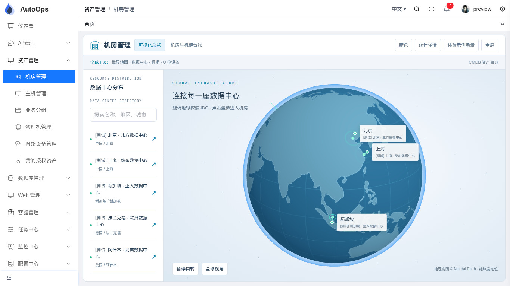
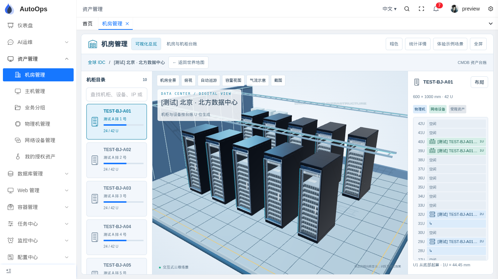
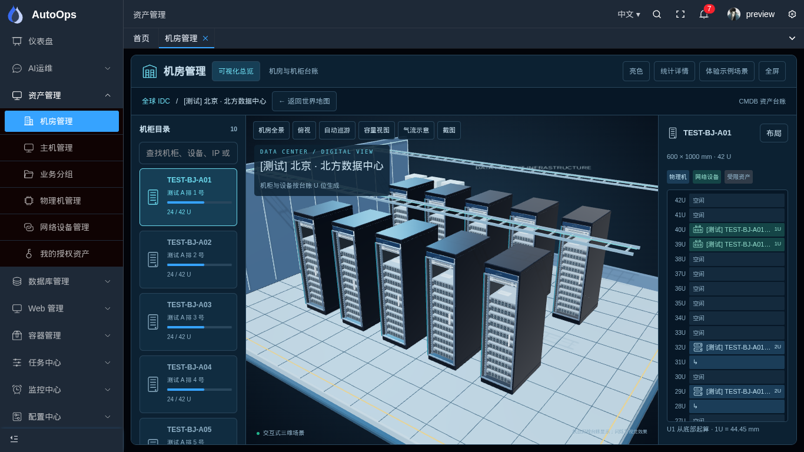
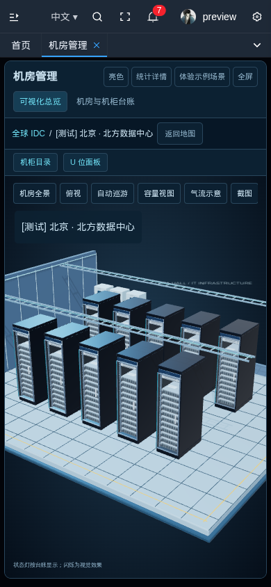
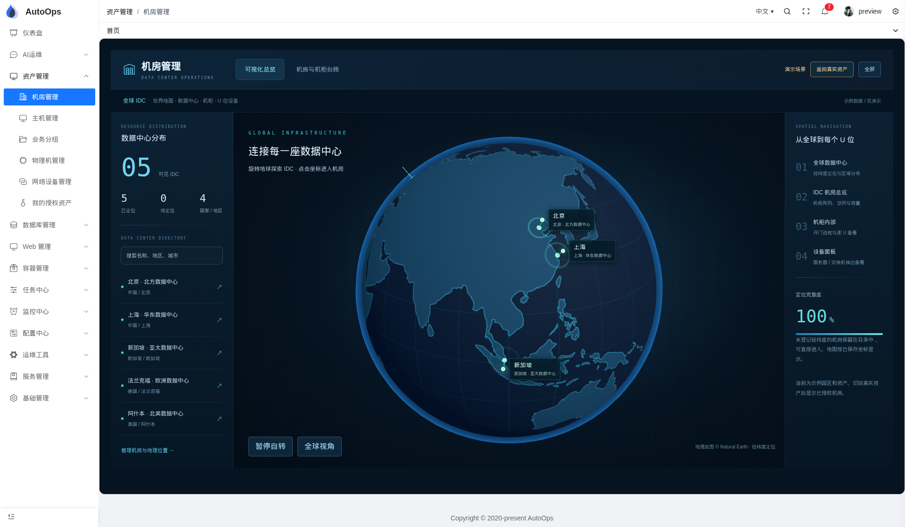
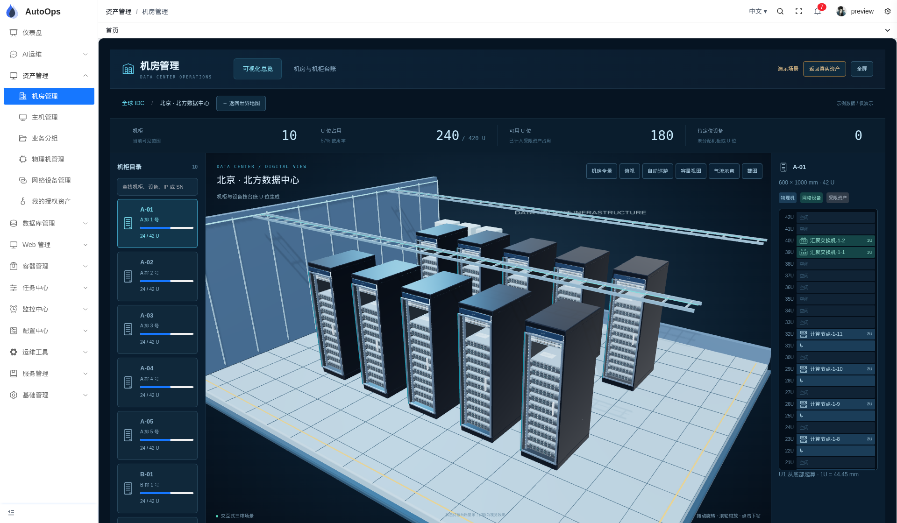
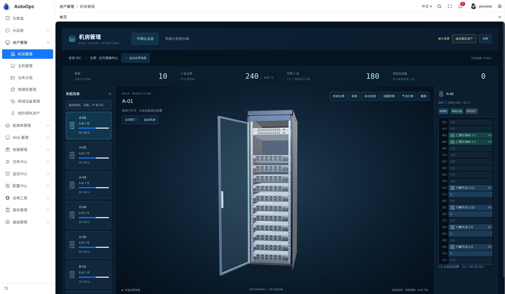
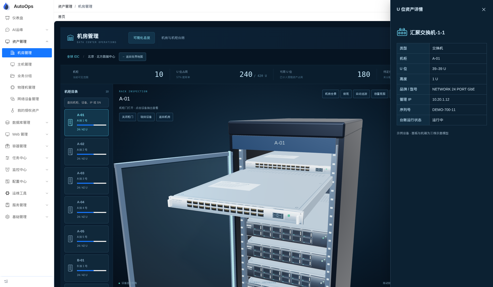
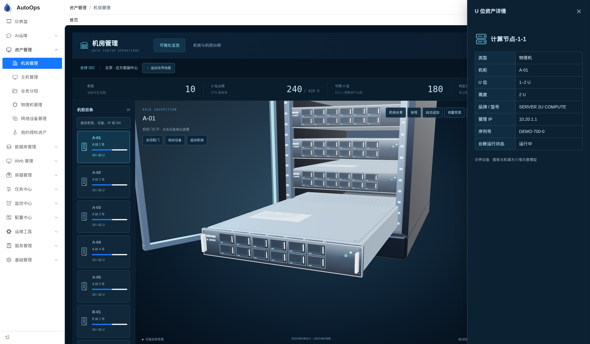

# 机房 3D 与 U 位管理

## 上游核对

2026-11-14 核对 https://github.com/opsre/AutoOps 的 `main`，提交 `346fee670e1a3f3a9bf497956a485b1aca81de55`。

已读取完整 Git tree，并在该提交的 `web/src`、`api/api`、`v4/autoops-web-v4/src`、`v4/autoops-api-v4/api` 检索 Three.js、机房、机柜。公开源码只有网络设备的自由文本位置示例，普通版和 v4 的 package.json 都没有 Three.js；没有可移植的机房 / 机柜 / U 位三维实现。本次在当前分支已有 CMDB 台账上新增功能，没有合并上游其他模块。后续若提供具体上游功能分支或提交，可继续对照同步。

## 亮暗主题、窗口布局与数据库测试数据（追加优化）

- 页面跟随全局亮暗主题，页面内不再提供单独的主题切换和全屏按钮。画布背景、地球贴图、场景雾色、侧栏、U 位、统计弹窗和设备抽屉一起切换；共享样式在 `three/facilityTheme.css`。
- `useFacilityViewport` 按页面实际顶部位置与 VisualViewport 计算剩余高度，监听窗口、父容器和全屏变化。地图/机房画布填满剩余空间，不设 720/800px 的固定最小高度；目录和 U 位独立滚动。画布页面不显示全局页脚，避免再次产生外层滚动。
- 窄屏通过「IDC 目录」「机柜目录」「U 位面板」切换覆盖侧栏，不把 U 位排到画布下方。Three.js 相机随纵横比调整距离，窗口缩窄后仍能看到场景。
- 顶部统计默认不占空间，点击「统计详情」打开当前地图或机房的统计弹窗。未分配机柜的资产也放入统计详情。

按用户本次明确要求，已将可辨识的测试资产写入 `api/config.yaml` 指向的 **autoops** 数据库。当前新增：

| 数据 | 新增数量 | 标识 |
| --- | ---: | --- |
| IDC | 5 | 名称 `[测试]` 开头；北京、上海、新加坡、法兰克福、阿什本 |
| 机柜 | 50 | `TEST-BJ/SH/SG/FRA/IAD-A01` 等，每地 10 柜 |
| 物理机 | 550 | 每柜 11 台，2U，U1/4/7/…/31 |
| 交换机 | 100 | 每柜 2 台，1U，U39/40 |

机房 ID 为 5、6、7、8、9。直接进入机房管理的 **CMDB 资产台账模式** 即可读取这些记录，无需开启前端示例。按现有平台/资产权限过滤，未修改任何角色授权。设备运行状态为离线，连接地址与凭据留空；数据备注为 `autoops:idc-sample:v1`，不代表生产设备。

导入器：`api/cmd/seed-datacenter`，使用应用配置与现有 DAO 的位置校验、事务锁及 U 位统计。**不会在服务启动时自动执行**，默认只读检查，明确 `-apply` 才写入。已有同名/SN 样例只跳过、不覆盖修改；标识属于其他资产时整批回滚。

```sh
cd api
go run ./cmd/seed-datacenter -config config.yaml          # 只读检查
go run ./cmd/seed-datacenter -config config.yaml -apply   # 明确导入
```

执行第二次新增数为 0。通过真实数据库调用 `LoadRackTopology` 校验：5 个 IDC、50 柜、650 设备、1200 个占用 U 位，冲突/越界均为 0。原有 2 个机房、3 个机柜、2 台物理机、3 台网络设备保留。

验证：新增导入器测试覆盖重复执行、保留用户修改、标识冲突时全批回滚。浏览器回归覆盖 1366×768、1280×600、1920×1080、390×844 的画布边界与外层无滚动，主题切换/设备抽屉、统计弹窗不改变画布尺寸、窄屏侧栏、页面控件移除与中英文即时切换。

以下截图中的样例数据从上述数据库拓扑读取后回放到浏览器，未使用前端「体验示例场景」：









## 统一机房管理与动态场景

资产管理仅保留 **机房管理**（`/cmdb/datacenter`）一个菜单，默认进入可视化总览。机房/机柜 CRUD 收进同页的「机房与机柜台账」标签。旧 `/cmdb/machine`、`/system/machine` 跳转到该台账；台账行的「3D 视图」回到对应 IDC。

交互参考：[Hightopo 数据中心可视化文章](https://blog.csdn.net/Hightopo/article/details/131510514)中的地图下钻、机柜开门和设备抽出流程。本实现使用 Three.js 原创程序化模型，没有拷贝文章的模型、贴图或 HT 商业代码。

1. **全球 IDC**：可旋转地球、脉冲定位标记、地理目录及定位完整度。点击地图 IDC 平滑飞近并进入机房；悬停或键盘聚焦标记会暂停自转。未登记经纬度的机房仍可从目录进入，不会猜测位置。
2. **机房总览**：机柜阵列、架空地板、墙体、走线架、照明与阴影。可俯视、自动巡游、查看真实 U 位容量、切换气流示意和保存 PNG。
3. **机柜巡检**：选择机柜后平滑聚焦，场景切到单柜视图，柜门打开。支持开关门、返回机房以及逐 U 位列表。
4. **设备巡检**：选择物理机或网络设备时，设备沿机柜前方抽出，镜头靠近面板。服务器有硬盘托架、把手、指示灯；网络设备有网口与光口；机箱补充顶盖、螺丝和散热孔。详情列出实际台账信息，授权后可跳转资产页。
5. **台账维护**：机房可登记国家/地区、城市、经纬度；机柜保存 U 数、底面尺寸、X/Z 坐标和朝向。物理机和网络设备保存起始 U 位和高度。

点击「体验示例场景」可预览五地 IDC、十柜数据大厅和服务器/交换机。前端示例必须主动开启，持续显示「演示场景 / 返回真实资产」，不调用拓扑或写入 API、不开放布局保存或资产操作。切到台账自动退出演示。默认始终使用当前用户有权访问的真实资产。

### 精度与视觉含义

柜体宽深、坐标、方向和 U 位读取台账；硬件面板、机房建筑、冷却设施是示意模型，不能当作具体品牌型号的 CAD 或机房实测建筑。指示灯颜色按台账运行状态显示，闪烁和气流粒子是视觉效果，没有虚构实时流量、温度、PUE 或告警数据。

U1 在底部，1U = 44.45 mm。设备占用闭区间 `[unitPosition, unitPosition + unitHeight - 1]`，包含物理机和网络设备。`unitPosition=0` 表示位置未登记，不会被画成已上架设备。关联机柜并有正数 U 位即占用空间，运行状态或资产状态的变化不会自动释放 U 位；移出设备需清除位置或机柜归属。

X/Z 为机柜底面中心，单位米；机房原点由管理员统一约定。0° 柜门朝向 +Z，支持 90°、180°、270°。未登记坐标的机柜显示自动排列提示；它仅用于浏览，不代表实测位置。保存真实坐标时会检查同机房已定位机柜的底面是否重叠。

机柜 U 位列表的颜色区分资产类型；状态来自 CMDB 台账，不代表实时监控。机柜外框高度包含示意底座，不是实测整柜高度。历史设备高度默认 1U，需要按真实硬件尺寸完善。

## 后端与权限

新增 `GET /api/v1/cmdb/idc/:id/topology`，受平台 `cmdb:read` 和对应机房 `get` 权限约束。机柜及设备另按各自 `get` 资产权限筛选。用户能看到机柜但无权查看设备时，仅返回匿名占位，不暴露 ID、名称、IP、SN、品牌及运行状态。

保存机柜继续使用 `PUT /cmdb/cabinet/:id`，保存设备继续使用原物理机 / 网络设备 CRUD 接口，沿用平台写权限和资产范围校验。

字段：

| 模型 | 新增字段 |
| --- | --- |
| CmdbIDC | country、city、longitude、latitude（经纬度可空） |
| CmdbCabinet | layoutX、layoutZ（可空）、rotation、widthMm、depthMm |
| CmdbPhysicalMachine | unitHeight |
| CmdbNetworkDevice | unitPosition、unitHeight |

事务在机柜行上加锁，统一校验两类设备重叠、越界、机房归属。写入和删除后重算 `usedUnit`；机柜缩容不能挤出设备，关联资产未移出时不能删除机柜或变更其机房。机房仍有关联机柜或设备时不能删除。三维接口实时按占用 U 位的并集统计，历史重叠、越界和未定位情况会提示。

重启新 API 后，已有模型的 GORM AutoMigrate 会增加字段。无需新增外部服务。前端新增锁定依赖 `three@0.187.0`，随 Vite 本地打包，不依赖 CDN、外部模型或在线图标。两个旧菜单合并到 `cmdb/datacenter`；菜单迁移优先保留已有 3D 菜单 ID，归并旧菜单角色关联与子级按钮，同时隐藏旧入口。新接口字段与菜单迁移需要重启更新后的 API 才会生效。

经纬度必须同时填写或同时清空；经度范围 [-180,180]，纬度范围 [-90,90]，0 是有效坐标。地图使用 Natural Earth 公有领域陆地轮廓，数据本地打包，来源说明见 `web/src/assets/maps/README.md`。无需地图密钥、在线瓦片或新增 Docker/K8s 服务。

## 实现文件与生命周期

- `DatacenterManagement.vue`：统一入口、地图/机房切换、台账内嵌、示例模式与路由同步。
- `components/IDCGlobe.vue`：地球、定位标记、地理镜头动画。
- `Datacenter3D.vue` + `components/RackScene.vue`：拓扑、机柜/U 位列表、巡检与设备详情。
- `three/facilityModels.js`：原生几何、CanvasTexture 面板、机柜和机房模型，共享设备纹理。
- `three/demoFacility.js`：仅前端示例数据。

动态场景使用 requestAnimationFrame，机房渲染上限约 30fps。页面隐藏或 KeepAlive 停用时暂停，卸载时释放几何体、共享纹理、材质、环境贴图、控件、监听器与 WebGL 上下文。遵循 reduced-motion，关闭自动旋转、脉冲、闪烁并直接完成镜头切换。无 WebGL 时保留目录、U 列表和详情操作。

## 验证与效果图

- `cd api && go test ./api/cmdb/... ./router/cmdb ./pkg/db ./router`：覆盖 U 位冲突与授权脱敏、经纬度校验与持久化、菜单合并和角色/按钮关联保留。
- `cd web && pnpm build`。
- `web/scripts/datacenter-check.cjs`：Chromium + Playwright 模拟全部 API，验证统一菜单、地图点击下钻、开关柜门、设备详情、台账跳转、旧路由、空数据、示例隔离、390px 窄屏、reduced-motion 与无 WebGL 降级。断言无写请求和未处理的浏览器错误。

运行浏览器检查需启动前端开发服务器，并提供 Playwright/Chromium 路径（若已默认安装可省略）：

```sh
PLAYWRIGHT_MODULE=/path/to/playwright CHROMIUM_PATH=/path/to/chrome node web/scripts/datacenter-check.cjs
```

[查看实际操作录像（41 秒，WebM）](../assets/screenshots/datacenter-walkthrough-v2.webm)，包含地图飞入、机房巡游、开关门及交换机/服务器抽出。

以下为示例模式下的实际浏览器截图：










